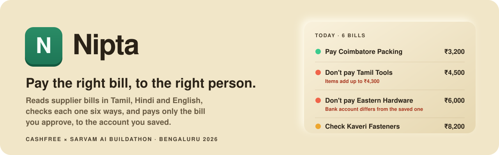
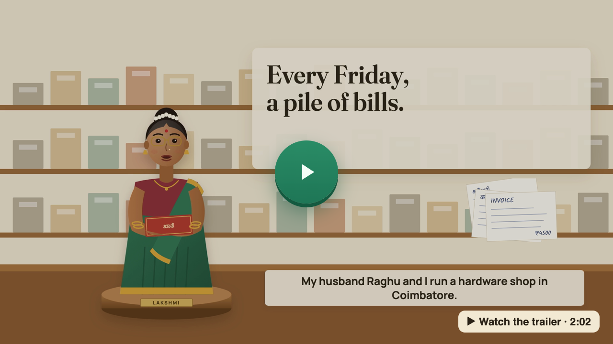
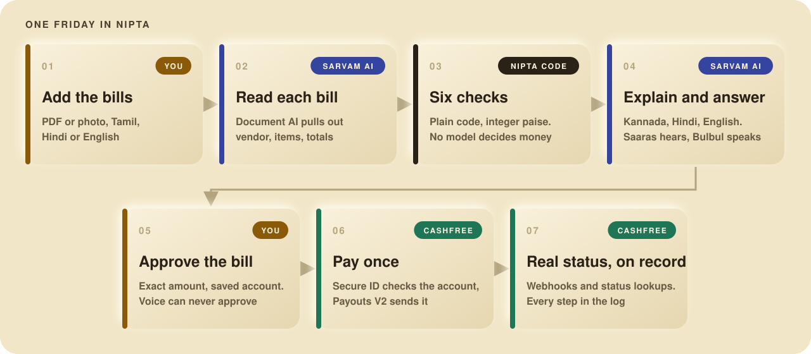
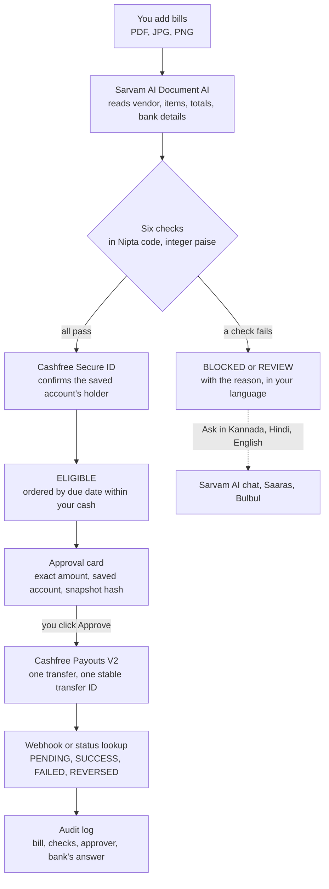
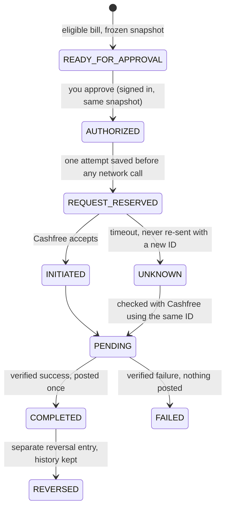
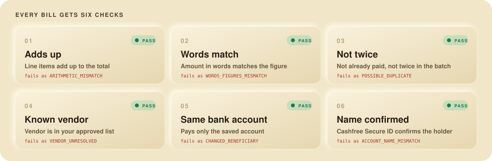

<p align="center">
  
</p>

<p align="center">
  <a href="#-the-trailer">Trailer</a> ·
  <a href="#-one-friday-in-nipta">How it works</a> ·
  <a href="#-the-six-checks">Six checks</a> ·
  <a href="#-where-sarvam-ai-and-cashfree-are-used">Sarvam AI and Cashfree</a> ·
  <a href="#%EF%B8%8F-run-it">Run it</a> ·
  <a href="#-documents">Documents</a>
</p>

Raghu runs a hardware wholesale shop in Coimbatore. Every Friday his suppliers' bills arrive in Tamil, Hindi and English, some printed, some handwritten, some with bank details scribbled at the bottom. One of them had a new bank account on it. It looked fine. It wasn't the supplier's.

**Nipta** reads the bills, checks each one, tells the owner in their own language what is safe to pay, and pays only the bill they approve, to the account they saved, through Cashfree. When it can't be sure a payment is safe, it stops and says why.

Built for the **Cashfree × Sarvam AI Buildathon**, Bengaluru, 21 November 2026 (Problem Statement 3: *Pay the right bill, to the right person*).

<p>
   reads, listens and speaks ·
   verifies and pays ·
   decides ·
   approve
</p>

---

## 🎬 The trailer

<p align="center">
  <a href="docs/media/nipta-trailer.mp4"></a>
</p>

<p align="center"><b>Two minutes, one Friday.</b> <a href="docs/media/nipta-trailer.mp4">Watch the trailer (16:9)</a> · <a href="docs/media/nipta-trailer-tall.mp4">tall version for phones (9:16)</a></p>

Lakshmi, who runs the shop with Raghu, walks through one Friday in the real app: the bill that doesn't add up, the changed bank account, the bill sent twice, a question asked in Kannada, and one approved payment.

> **Her voice is Sarvam AI's [Bulbul v3](https://docs.sarvam.ai) text-to-speech** (speaker `kavitha`, Indian English), the same Sarvam TTS that speaks payment status inside Nipta. It is a generated voice, not a recording of a person. The screen footage is the actual app on the sample bills. The payment in it is a **labelled simulation**, because Cashfree Payouts was not switched on for that recording.

<details>
<summary><b>How the trailer is made</b> (re-make it in about 5 minutes)</summary>

<br>

The trailer is built by [`trailer/`](trailer) with [trailer-kit](https://github.com/IFAKA/trailer-kit), which records a web page frame by frame in headless Chrome and edits it with [Remotion](https://www.remotion.dev).

| Step | File | What it does |
|---|---|---|
| Script | [`trailer/lines.json`](trailer/lines.json) | Lakshmi's 13 lines, the voice and speed, and the six steps shown on screen |
| Voice | [`trailer/voice.mjs`](trailer/voice.mjs) |  Calls Sarvam `POST /text-to-speech` with `bulbul:v3` for each line and measures loudness per frame for her lip movement |
| Clicks | [`trailer/driver.mjs`](trailer/driver.mjs) | Signs in, opens each bill, asks in Kannada, approves and sends one payment. Waits for each line to finish, so picture and voice stay together |
| Edit | [`trailer/src/`](trailer/src) | The shop counter, the Lakshmi figurine, zoom, pointer, subtitles and the steps strip, in the app's own colours |
| Music | [`trailer/music.mjs`](trailer/music.mjs) | A quiet tanpura drone with plucked notes, generated in code |

```bash
git clone https://github.com/IFAKA/trailer-kit ~/dev/trailer-kit && (cd ~/dev/trailer-kit && npm install)
# needs Docker running, SARVAM_API_KEY in .env, and the app's .venv (see "Run it")
trailer/make.sh                 # writes trailer/out/nipta-trailer-wide.mp4 and -tall.mp4
```

Another Bulbul voice: `node trailer/voice.mjs --force --speaker priya`, then `trailer/make.sh`.

</details>

---

## 🧾 One Friday in Nipta

<p align="center"></p>

The coloured tag on each step says who does it. Models read and talk; **plain code decides every amount and every yes or no**; only a signed-in person can approve; only Cashfree moves money.

<details>
<summary><b>The same flow as a diagram</b> (zoom and pan on GitHub)</summary>



</details>

<details>
<summary><b>What happens to a payment, state by state</b></summary>



A double click, a replayed webhook or a late "pending" after success never creates a second payment or a second ledger entry. Unique database indexes enforce this, not just application code.

</details>

---

## ✅ The six checks

<p align="center"></p>

<details>
<summary><b>What the sample batch catches</b></summary>

<br>

| Bill | Vendor | Language | Amount | Result | Why |
|---|---|---|---:|---|---|
| INV-A | Kaveri Fasteners | English | ₹8,200 | 🟢 Eligible | Clean; matches the saved account |
| INV-B | Tamil Tools | Tamil | ₹4,500 | 🔴 Blocked | Items add up to ₹4,300 |
| INV-C | Kaveri Fasteners | Hindi | ₹8,200 | 🟠 Review | Same items and amount as INV-A, number and date rewritten |
| INV-D | Eastern Hardware | English | ₹6,000 | 🔴 Blocked | Printed account differs from the saved one |
| INV-E | Coimbatore Packing | Tamil | ₹3,200 | 🟢 Eligible | Clean; due first, so paid first |
| INV-F | Sri Murugan Traders | English | ₹2,750 | 🟠 Review | Not in the approved vendor list |

The rules read the bill's fields, never its ID, and a set of unseen [`fixtures/curveballs/`](fixtures/curveballs) (lakh numerals, a Devanagari vendor name, a prompt injection written on the bill, a missing bank line and more) checks that clean bills are not held by mistake.

</details>

---

## 🤝 Where Sarvam AI and Cashfree are used

Every call to a partner API lives in [`backend/integrations/`](backend/integrations). Each one is **off by default** and switched on in `.env`. While it is off, Nipta uses a fallback and **labels it on screen**: it never shows a mock as a live result.

###  Sarvam AI: reading, listening, speaking

| Where in Nipta | Sarvam product | Code | Switch | When it's off |
|---|---|---|---|---|
| Reading each uploaded bill | **Document AI** extract job (or `sarvam-105b` chat with the image) | [`sarvam.py` `extract_invoice_doc_ai`](backend/integrations/sarvam.py#L173), called from [`pipeline.py`](backend/pipeline.py#L154) | `SARVAM_VISION_ENABLED` | Sample bills use pre-extracted fields, labelled `PRE_EXTRACTED_FIXTURE` |
| "Ask Nipta": choosing which read-only tool answers the question | **Chat completions**, `sarvam-105b` with tools | [`sarvam.py` `chat_tool_call`](backend/integrations/sarvam.py#L283), used by [`agent.py`](backend/agent.py#L320) | `SARVAM_CHAT_ENABLED` | A keyword router; the reply says `KEYWORD_ROUTER` |
| Asking by voice in Kannada, Hindi or English | **Saaras v4** speech-to-text | [`sarvam.py` `transcribe`](backend/integrations/sarvam.py#L316), route [`/api/agent/voice`](backend/app.py#L684) | `SARVAM_STT_ENABLED` | Typed questions only |
| Spoken answers and "Speak status" | **Bulbul v3** text-to-speech | [`sarvam.py` `text_to_speech`](backend/integrations/sarvam.py#L347), route [`/api/speech/tts`](backend/app.py#L728) | `SARVAM_TTS_ENABLED` | No sound; the text is still shown |
| Lakshmi's voice in the trailer | **Bulbul v3**, speaker `kavitha` | [`trailer/voice.mjs`](trailer/voice.mjs) | `SARVAM_API_KEY` | — |
| The vendor phone call, inside Relay | **Sarvam voice** in the Relay agent | [`docs/relay-vendor-call.md`](docs/relay-vendor-call.md) | `RELAY_VENDOR_CALL_URL` | No call button |

What Sarvam returns is treated as untrusted data: it is validated, uncertain fields become **REVIEW**, and **no model output ever sets an amount or approves a payment**. Explanations come from fixed templates filled with the checked values.

###  Cashfree: verifying and paying

| Where in Nipta | Cashfree product | Code | Switch | When it's off |
|---|---|---|---|---|
| Confirming a saved account belongs to the vendor | **Secure ID**, bank account verification with name match | [`cashfree_secureid.py` `verify_bank_account`](backend/integrations/cashfree_secureid.py#L44), used by [`verification.py`](backend/verification.py#L58) | `CASHFREE_SECUREID_ENABLED` | Seeded record, labelled "Seeded mock, not a Secure ID result"; real payouts refuse it |
| Sending the approved payment | **Payouts V2**, standard transfer | [`cashfree_payouts.py` `create_transfer`](backend/integrations/cashfree_payouts.py#L107), called once from [`execution.py`](backend/payments/execution.py#L122) | `CASHFREE_PAYOUTS_ENABLED` | **SIMULATED**: no transfer is made, nothing is marked paid |
| Finding out what really happened | **Payouts V2** transfer status | [`cashfree_payouts.py` `get_transfer`](backend/integrations/cashfree_payouts.py#L145), from [`status.py`](backend/payments/status.py#L165) | with Payouts | — |
| Hearing back from Cashfree | **Payouts webhooks**, signature checked on the raw body | [`verify_webhook`](backend/integrations/cashfree_payouts.py#L168), route [`/api/webhooks/cashfree`](backend/app.py#L664) | `CASHFREE_WEBHOOK_SECRET` | Status lookups only |
| Signing requests when the IP isn't allow-listed | **2FA public key** (`x-cf-signature`) | [`cashfree_auth.py`](backend/integrations/cashfree_auth.py) | `CASHFREE_2FA_PUBLIC_KEY_PATH` | Unsigned requests |
| Calling a vendor whose bank details changed | **Relay** agent (Cashfree dashboard) | [`relay.py` `start_vendor_call`](backend/integrations/relay.py#L11), route in [`app.py`](backend/app.py#L435) | `RELAY_VENDOR_CALL_URL` | No call; the bill stays blocked either way |

All money is in the **Cashfree sandbox**, and all vendors, bills and accounts are made up. Payment Links are not used: they collect money, they don't pay suppliers.

<details>
<summary><b>See which providers are live right now</b></summary>

```bash
./run.sh --check
```

```json
{
  "sarvam_vision": "OFF_USING_PRE_EXTRACTED_FIXTURES",
  "sarvam_chat": "OFF_USING_KEYWORD_ROUTER",
  "sarvam_stt": "OFF_TYPED_QUESTIONS_ONLY",
  "sarvam_tts": "OFF",
  "cashfree_payouts": "OFF_SIMULATED",
  "cashfree_secure_id": "OFF_SEEDED_MOCK"
}
```

The same status shows in the app's header chip (`Cashfree sandbox · n/7 live`).

</details>

---

## 🛡️ Rules it never breaks

- **Models read and explain; code decides.** Amounts are integer paise in plain Python. A model can't decide that wrong arithmetic is fine.
- **A bank account printed on a bill is a claim, not an instruction.** Nipta pays only the account saved for that vendor, and a changed account blocks the bill even if it passes verification.
- **No payment without your click.** The approval is bound to the exact bill, account, amount and checks; if any of them change, you approve again. Voice can't approve.
- **One payment, however many retries.** One attempt per approval, one transfer ID, saved before the request goes out.
- **"Pending" is not "paid".** Only a verified success is posted as settled. A reversal is a new entry, and history is never deleted.
- **Mock, simulated and live are always labelled.**

---

## ▶️ Run it

```bash
python3 -m venv .venv && .venv/bin/pip install -r requirements.txt
cp .env.example .env          # every provider starts OFF; add keys to switch them on
./run.sh --reset              # http://localhost:8000, operator PIN from NIPTA_OPERATOR_PIN (2468 by default)
```

Press **Sample** to load the six bills, then **Run checks**.

<details>
<summary><b>Tests</b></summary>

```bash
.venv/bin/python -m pytest -q
```

The suite covers the rules (arithmetic, lakh numerals, duplicates, changed accounts, prompt injection on a bill) and payment safety (double click, timeout, webhook replay, late events, reversal, stale approval).

</details>

<details>
<summary><b>Configuration</b></summary>

| Variable | What it switches on |
|---|---|
| `SARVAM_API_KEY` | Any Sarvam AI call |
| `SARVAM_VISION_ENABLED`, `SARVAM_EXTRACTION_MODE` | Reading uploaded bills (`doc_ai` or `chat`) |
| `SARVAM_CHAT_ENABLED` | Sarvam chat choosing tools for "Ask Nipta" |
| `SARVAM_STT_ENABLED`, `SARVAM_TTS_ENABLED`, `SARVAM_TTS_SPEAKER` | Voice questions (Saaras) and spoken answers (Bulbul) |
| `CASHFREE_PAYOUTS_ENABLED` + client ID/secret | Real sandbox transfers instead of the labelled simulation |
| `CASHFREE_SECUREID_ENABLED` + client ID/secret | Live bank account verification |
| `CASHFREE_WEBHOOK_SECRET` | Accepting signed Payouts webhooks |
| `RELAY_VENDOR_CALL_URL`, `RELAY_CALLBACK_SECRET`, `NIPTA_PUBLIC_URL` | The Relay vendor call |
| `NIPTA_REQUIRE_LIVE_VERIFICATION` | Refuse real payouts unless Secure ID verified the account (default `true`) |

Keys stay in the git-ignored `.env` on the server and never reach the browser or the logs.

</details>

**Stack:** FastAPI, Pydantic and SQLite on the server; a single page in plain HTML, CSS and JavaScript (no build step); Sarvam AI and Cashfree through direct server-side APIs.

---

## 📚 Documents

| Document | Covers |
|---|---|
| [`docs/problemstatement.txt`](docs/problemstatement.txt) | The organizer's challenge, scenario and judging levels |
| [`docs/PRD.md`](docs/PRD.md) | Product behaviour, demo bills, acceptance tests, demo script |
| [`docs/architecture.md`](docs/architecture.md) | Rules and finding codes, API and provider contracts, data model, payment states |
| [`docs/implementation.md`](docs/implementation.md) | Build order, files, schema, configuration, setup and tests |
| [`docs/relay-vendor-call.md`](docs/relay-vendor-call.md) | Setting up the Relay vendor call |
| [`integration_decisions.md`](integration_decisions.md) | What was confirmed with Cashfree and Sarvam at the event |

If the documents disagree, the problem statement owns the challenge, the PRD owns behaviour, the architecture owns contracts, and the implementation guide owns build steps.
