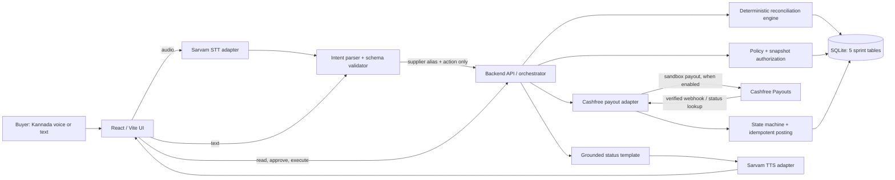
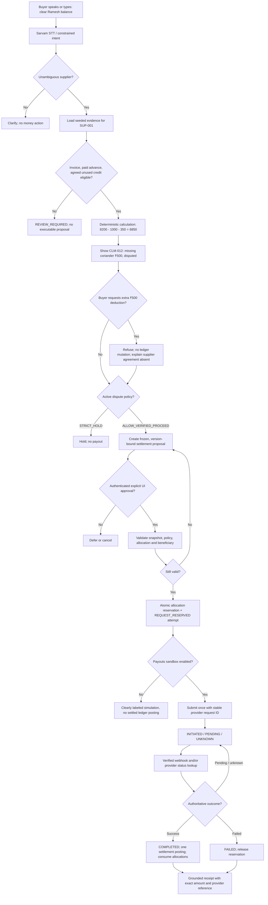
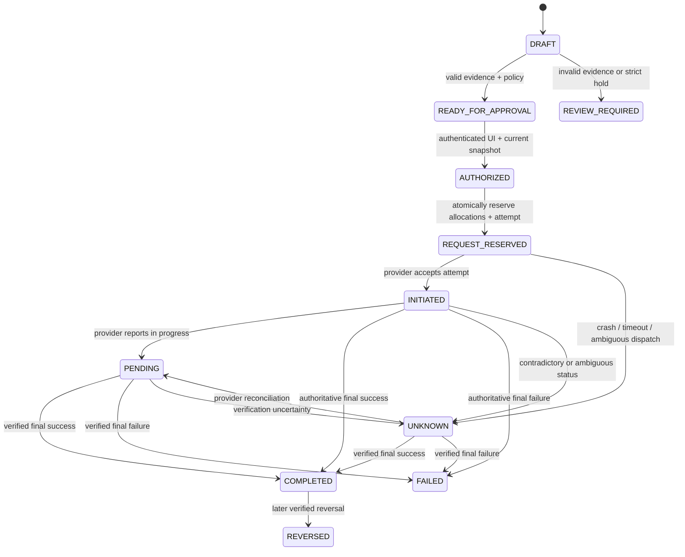

# Nipta

**Supplier settlement backed by evidence, in the language merchants already use.**

Nipta is a vernacular-first B2B supplier reconciliation and settlement agent. It is being built for the **Cashfree × Sarvam AI Buildathon** in Bengaluru on 21 November 2026. A merchant says something short, in Kannada or Hindi, like *"Clear Ramesh Vegetables' balance."* Nipta then:

1. Collects the invoices, advances, credits and disputed claims for that supplier.
2. Works out the amount actually owed, using deterministic arithmetic.
3. Explains which adjustments were included and which were left out, and why.
4. Asks the merchant to approve the exact amount and beneficiary.
5. Runs the payout through Cashfree Payouts (sandbox) and reports only the status it actually knows.

> **Status:** This repo holds the design specs (`docs/`). The application code is planned (see [Repository layout](#repository-layout)). Cashfree and Sarvam API details are **not yet verified** and have to be confirmed with event engineers before integration.

---

## Table of contents

- [The problem](#the-problem)
- [What Nipta does differently](#what-nipta-does-differently)
- [Demo scenario](#demo-scenario)
- [Safety invariants](#safety-invariants)
- [Architecture](#architecture)
- [Reconciliation rules](#reconciliation-rules)
- [Approval, execution and idempotency](#approval-execution-and-idempotency)
- [Payment state machine](#payment-state-machine)
- [Data model](#data-model)
- [API](#api)
- [Tech stack](#tech-stack)
- [Repository layout](#repository-layout)
- [Getting started](#getting-started)
- [Configuration](#configuration)
- [Testing](#testing)
- [Demo script (180 seconds)](#demo-script-180-seconds)
- [Scope and non-goals](#scope-and-non-goals)
- [Open integration questions](#open-integration-questions)
- [Team and ownership](#team-and-ownership)
- [Documentation](#documentation)

---

## The problem

Small Indian food and retail businesses (restaurants, cloud kitchens, bakeries, fresh-produce shops) usually buy from 5 to 20 repeat suppliers. Working out what they **actually** owe a supplier is harder than it sounds:

- **Records are scattered.** Invoices come as paper slips or WhatsApp photos. Advances go out as separate UPI payments. Credits for damaged goods get agreed in voice notes. Shortage claims live in staff memory.
- **Reconciliation is manual.** The owner digs through chats, notebooks and payment history.
- **Mistakes cost money either way.** Ignoring valid credits means overpaying. Deducting a claim the supplier never agreed to starts a dispute and can disrupt future deliveries.
- **Execution is disconnected.** The payment happens in a separate banking app, with nothing linking it back to the evidence.
- **Naive automation is unsafe.** A voice bot that pulls out a number and calls a payment API can mishear an amount, apply a deduction nobody agreed to, pick the wrong beneficiary, or pay twice.

Payment rails can move money once the amount is known, and accounting tools can track credit notes. Neither one establishes *commercial agreement* from informal, multilingual records. Nipta closes that gap **before** any money moves.

## What Nipta does differently

| Step | Component | Rule |
|---|---|---|
| Understand the request | Sarvam AI STT + structured intent | Speech is an input channel. It is never financial evidence or authorization. |
| Retrieve evidence | Backend + merchant-owned records | The supplier is resolved from approved records, not from model output. |
| Reconcile | Deterministic backend engine | Integer paise only. The LLM never calculates authoritative amounts. |
| Explain | UI + grounded language templates | Every included and excluded adjustment is shown with its evidence. |
| Authorize | Authenticated UI over an immutable snapshot | Voice cannot approve. Any change to amount or beneficiary invalidates the approval. |
| Execute | Cashfree Payouts adapter (feature-gated) | Idempotent, one attempt per settlement, no blind retries. |
| Confirm | Verified webhook and/or status lookup → Sarvam TTS | "Initiated", "pending", "failed" and "completed" are never treated as the same thing. |

The system keeps **three separate verifications**:

1. **Ledger and commercial agreement.** Is the advance confirmed and linked to this invoice? Did the supplier explicitly agree to this exact credit amount, and is the credit still unused?
2. **Beneficiary.** Do the saved payee details pass the configured checks? The UI never labels a merchant-confirmed record as "Cashfree verified".
3. **Payment status.** Has Cashfree reported a confirmed final state? API acceptance or receiving a webhook does **not** prove the payment completed.

## Demo scenario

**Supplier:** Ramesh Vegetables, Bengaluru (`SUP-001`). All records are curated demo data.

| Record | Type | Description | Amount | State | Treatment |
|---|---|---|---:|---|---|
| `INV-104` | Invoice | Produce delivery, 19 Nov | +₹8,200 | `ISSUED`, buyer-accepted (`PDF_BILL`) | Included |
| `ADV-019` | Advance | Earlier UPI payment, 17 Nov | −₹1,000 | `PAYMENT_CONFIRMED`, linked, `UNAPPLIED` (`UPI_REF`) | Included |
| `CRD-007` | Credit | Damaged tomatoes | −₹350 | `SUPPLIER_APPROVED`, linked, `UNAPPLIED` (`WHATSAPP_NOTE`) | Included |
| `CLM-012` | Claim | ₹500 of coriander reported missing | −₹500 | `DISPUTED`, not supplier-approved | **Excluded** |

```
Verified payable = ₹8,200 − ₹1,000 − ₹350 = ₹6,850
```

The buyer says ₹500 of coriander was missing, but Ramesh has not agreed to a ₹500 credit. Nipta **refuses to deduct it**, keeps the claim open, and explains why in the merchant's language. The payable stays ₹6,850, not ₹6,350.

### Dispute policies

| Policy | Behaviour |
|---|---|
| `ALLOW_VERIFIED_PROCEED` (demo default) | The claim stays open. The merchant can choose to pay the verified ₹6,850 or defer. |
| `STRICT_HOLD` | Any material unresolved claim blocks payout. The calculation is still shown, but there is no approve button. |

The active policy shows as a read-only badge. Only a separately authenticated operator action can change it, and changing it invalidates every existing proposal and approval. The model can never toggle it.

## Safety invariants

1. Money amounts are computed only by integer-paise backend logic, never by model output.
2. An unapproved or disputed credit never reduces the payable.
3. An advance or credit can reduce an invoice **once**, up to its remaining balance.
4. A short-delivery allegation is not supplier agreement.
5. A verified payable is not an order to pay. Policy and explicit UI authorization are still required.
6. Voice cannot authorize a payout, change bank details, or switch the dispute policy.
7. A settlement has at most one active or uncertain provider attempt. When status is unknown, no new transfer is created automatically.
8. HTTP acceptance or a received webhook does not by itself mean the payment completed.
9. A confirmed successful attempt produces exactly one immutable `SETTLEMENT` ledger entry. A reversal adds a separate compensating `REVERSAL` entry.
10. Secrets stay on the server, beneficiary values are masked in the browser, and the UI always distinguishes sandbox from simulation.

## Architecture

Nipta is a **modular monolith**: one FastAPI process, one SQLite database, and thin adapters for Sarvam and Cashfree.



**Trust boundaries:** Browser input and model output are untrusted. Only authenticated backend requests and validated server-owned data can change a settlement. Provider webhooks are untrusted until verified with the provider's current authentication scheme. The Cashfree adapter never accepts an amount calculated in the frontend.

### End-to-end flow



## Reconciliation rules

Amounts are signed integer **paise**: invoices are positive, and eligible advances and credits are negative.

```text
eligible_invoice_total
  - allocated_verified_advances
  - allocated_approved_credits
  - previously_applied_payments
= verified_payable_paise
```

Each record is checked for eligibility individually:

- **Invoice:** must match supplier, ID and amount against a trusted record.
- **Advance:** needs evidence of a completed payment, an explicit link to this supplier and invoice, and an unconsumed balance. A UPI reference alone does not prove what the transfer was for.
- **Credit:** needs **explicit supplier agreement to the exact amount**, a source reference, the linked invoice, and an unused balance. Neither an internal buyer `APPROVED` flag nor a supplier saying "received your complaint" is enough.
- **Claim:** `RECORDED`, `EVIDENCE_ATTACHED` and `SUPPLIER_ACKNOWLEDGED` do **not** mean `SUPPLIER_APPROVED`. `DISPUTED` records never reduce the payable.
- **Consumption:** advances and credits move from `UNAPPLIED` to `RESERVED` (together with the payout attempt) to `APPLIED` (only on confirmed success). A verified failure releases them. While the state is `UNKNOWN`, they stay reserved.

The engine returns `included_records[]`, `excluded_claims[]`, `ledger_version`, the computed amount, and a policy-driven `can_proceed` flag. It rejects a negative payable and incomplete or stale evidence. For a given ledger version and policy, the output is always the same.

## Approval, execution and idempotency

**Frozen snapshot.** Each settlement gets a unique `SET-...` ID and a canonical JSON snapshot:

```json
{
  "settlement_id": "SET-001",
  "merchant_id": "MER-001",
  "supplier_id": "SUP-001",
  "beneficiary_id": "BEN-001",
  "currency": "INR",
  "amount_paise": 685000,
  "approved_record_ids": ["ADV-019", "CRD-007", "INV-104"],
  "allocation_ids": ["ALLOC-ADV-019-INV-104", "ALLOC-CRD-007-INV-104"],
  "ledger_version": 7,
  "dispute_policy": "ALLOW_VERIFIED_PROCEED"
}
```

`approval_hash = SHA256(canonical_json(snapshot))` is an integrity fingerprint, **not** a credential.

**Approve and execute are separate steps:**

- `POST /approve` takes the snapshot hash and `acknowledge_open_dispute: true`. It records `approver_id`, `approved_at` and an expiry.
- `POST /execute` takes **no** amount and no dispute flag. It only executes a snapshot that was already approved, has not expired, and has not changed.

**Transaction order:**

1. **Prepare:** verify evidence, freeze the snapshot and hash.
2. **Approve:** an authenticated UI click is bound to the exact snapshot.
3. **Reserve** (`BEGIN IMMEDIATE`): recheck everything, reserve allocations, create **one** payment attempt with a stable provider request ID, and commit *before* any network I/O.
4. **Dispatch:** call Cashfree once. A timeout leads to `UNKNOWN`, and the stored attempt is never replaced with a new transfer ID.
5. **Confirm success:** in one transaction, set `COMPLETED`, insert one `SETTLEMENT` row, consume allocations, and write an audit event.
6. **Confirm failure:** set `FAILED` and release the reservations. Nothing is posted.
7. **Reverse:** append a linked `REVERSAL` entry. History is never deleted.

## Payment state machine



- `REQUEST_RESERVED` is **internal**. It means an attempt was committed locally, not that Cashfree received it.
- A late `PENDING` event never downgrades `COMPLETED`.
- `SIMULATED` is a separate mode. It never counts as `COMPLETED` and never creates a settlement posting.

## Data model

The sprint uses five SQLite tables. This is a demo schema, **not** a production double-entry ledger.

| Table | Key fields |
|---|---|
| `suppliers` | `id`, `merchant_id`, `display_name`, `aliases_json`, `beneficiary_id`, `beneficiary_masked`, `beneficiary_version`, `verification_status` |
| `ledger_entries` | `id`, `supplier_id`, `invoice_id`, `kind` (`INVOICE`/`ADVANCE`/`CREDIT`/`CLAIM`/`SETTLEMENT`/`REVERSAL`), `amount_paise`, `commercial_state`, `evidence_ref`, `agreement_ref`, `agreement_version`, `linked_invoice_id`, `allocation_state`, `reserved_settlement_id`, `consumed_settlement_id`, `payment_attempt_id`, `reverses_entry_id`, `ledger_version` |
| `settlements` | `id`, `merchant_id`, `supplier_id`, `amount_paise`, `currency`, `snapshot_json`, `snapshot_hash`, `ledger_version`, `policy_version`, `beneficiary_version`, `state`, `approver_id`, `approved_at`, `expires_at` |
| `payment_attempts` | `id`, `settlement_id` (unique), `provider_request_id` (unique), `provider_ref`, `state`, `dispatch_started_at`, `verified_at`, `posting_recorded_at`, `last_provider_status` |
| `audit_events` | `id`, `dedupe_key` (unique where present), `actor`, `action`, `object_id`, `created_at`, `metadata_json` |

Uniqueness constraints that enforce exactly-once posting:

```sql
CREATE UNIQUE INDEX IF NOT EXISTS one_settlement_posting_per_attempt
  ON ledger_entries(payment_attempt_id)
  WHERE kind = 'SETTLEMENT' AND payment_attempt_id IS NOT NULL;

CREATE UNIQUE INDEX IF NOT EXISTS one_reversal_per_posting
  ON ledger_entries(reverses_entry_id)
  WHERE kind = 'REVERSAL' AND reverses_entry_id IS NOT NULL;

CREATE UNIQUE INDEX IF NOT EXISTS one_attempt_per_settlement
  ON payment_attempts(settlement_id);

CREATE UNIQUE INDEX IF NOT EXISTS unique_provider_request
  ON payment_attempts(provider_request_id);
```

Allowed `commercial_state` values are validated **per record kind**. Invoice, advance, credit and claim states are different concepts. Payout status lives in `payment_attempts`, not in `ledger_entries`.

## API

These are Nipta's internal routes. They are **not** Cashfree endpoints. All money values are integer paise.

| Method | Route | Purpose |
|---|---|---|
| `POST` | `/api/intent/parse` | Audio (`audio_file`) or `text_input` + `language` (`kn-IN`/`hi-IN`) → transcript + validated intent |
| `POST` | `/api/tts/speak` | `{settlement_id, language}` → speech generated from server-side status text only |
| `GET` | `/api/suppliers/{id}/reconciliation` | Verified payable, included/excluded evidence, ledger version, masked beneficiary |
| `POST` | `/api/settlements` | `{supplier_id, invoice_id}` → frozen snapshot, hash, expiry |
| `POST` | `/api/settlements/{id}/approve` | `{snapshot_hash, acknowledge_open_dispute: true}` → bind the approver to the snapshot |
| `POST` | `/api/settlements/{id}/execute` | Empty body → reserve or return the single attempt; no implicit approval |
| `GET` | `/api/settlements/{id}/status` | Authoritative state, provider reference, `ledger_posted` |
| `POST` | `/api/webhooks/cashfree` | Raw body + headers → verify, normalize, dedupe, hand off to the ledger service |

**Intent schema** (untrusted until validated). Allowed intents: `CHECK_BALANCE`, `REQUEST_DEDUCTION`, `PREPARE_SETTLEMENT`, `CANCEL`, `UNKNOWN`. No intent maps to payment authorization.

```json
{
  "transcript": "ರಮೇಶ್ ವೆಜಿಟೇಬಲ್ಸ್ ಬಾಕಿ ಕ್ಲಿಯರ್ ಮಾಡಿ",
  "language": "kn-IN",
  "input_mode": "PREPARED_AUDIO",
  "parsed_intent": {
    "intent": "CHECK_BALANCE",
    "supplier_alias": "Ramesh Vegetables",
    "resolved_supplier_id": "SUP-001",
    "requested_deduction_amount_paise": null
  }
}
```

**Reconciliation response (abridged):**

```json
{
  "supplier": {
    "id": "SUP-001",
    "display_name": "Ramesh Vegetables",
    "beneficiary_masked": "UPI: rameshveg@okaxis (BEN-001)",
    "beneficiary_verification_status": "MERCHANT_CONFIRMED_RECORD"
  },
  "invoice_id": "INV-104",
  "dispute_policy": "ALLOW_VERIFIED_PROCEED",
  "ledger_version": 7,
  "currency": "INR",
  "verified_payable_paise": 685000,
  "can_proceed": true,
  "included_records": ["INV-104", "ADV-019", "CRD-007"],
  "excluded_claims": [
    {"id": "CLM-012", "amount_paise": -50000, "claim_state": "DISPUTED",
     "reason": "Supplier agreement to ₹500 shortage credit missing"}
  ]
}
```

See [`docs/architecture.md` §7](docs/architecture.md) for the full contracts and the shared Python interfaces.

## Tech stack

| Layer | Choice |
|---|---|
| Frontend | Vite + React + TypeScript, single responsive screen |
| Backend | FastAPI + Pydantic, `httpx` for outbound calls |
| Database | SQLite (WAL, `BEGIN IMMEDIATE` for critical transactions), single process |
| Language AI | Sarvam AI: STT, structured intent, TTS (Kannada primary, Hindi/Hinglish secondary) |
| Payments | Cashfree Payouts sandbox, behind a feature flag |
| Config | `.env` on the server (git-ignored), `.env.example` committed |

## Repository layout

Current contents:

```text
nipta/
├── README.md
└── docs/
    ├── problemstatement.txt   # Problem statement v2.3 (customer problem, commercial claims)
    ├── PRD.md                 # Product requirements v2.7 (behaviour, scope, T01–T16)
    └── architecture.md        # System architecture v1.2 (contracts, schema, state recovery)
```

Planned implementation layout (from `docs/architecture.md` §13):

```text
nipta/
├── .env.example
├── backend/
│   ├── main.py                 # routers, CORS, error middleware
│   ├── config.py               # env / provider gates
│   ├── contracts.py            # shared Pydantic request/response models
│   ├── db/
│   │   ├── schema.sql          # five-table DDL + uniqueness constraints
│   │   ├── seed.py             # Ramesh Vegetables scenario
│   │   └── database.py         # WAL, BEGIN IMMEDIATE transactions
│   ├── modules/
│   │   ├── sarvam/             # router, stt_client, intent_parser, tts_client, response_templates
│   │   ├── ledger/             # router, calculator, policy, snapshot, lifecycle (sole DB mutation path)
│   │   └── cashfree/           # router (webhook), adapter, verifier, mapper
│   └── tests/
│       └── test_safety_gates.py
├── frontend/
│   └── src/
│       ├── App.tsx
│       ├── api/client.ts
│       └── components/         # VoiceCommandBar, EvidenceLedger, PolicyHeader,
│                               # ApprovalCard, StatusTimeline, AuditDrawer
└── demo_assets/
    ├── kn_clear_balance.wav
    └── kn_deduct_500.wav
```

## Getting started

> These steps describe the planned setup. They will work once the `backend/` and `frontend/` code lands.

**Prerequisites:** Python 3.11+, Node.js 18+, and Sarvam AI API access. Cashfree Payouts sandbox access is optional; without it, Nipta runs in clearly labelled simulation mode.

```bash
# 1. Configure
cp .env.example .env            # fill in Sarvam / Cashfree sandbox credentials

# 2. Backend
cd backend
python -m venv .venv && source .venv/bin/activate
pip install fastapi uvicorn pydantic httpx
python db/seed.py               # create SQLite DB and seed the Ramesh scenario
uvicorn main:app --reload

# 3. Frontend (separate terminal)
cd frontend
npm install
npm run dev
```

The frontend polls `GET /api/settlements/{id}/status` for updates. The MVP has no SSE or websockets.

## Configuration

Planned environment variables. Exact names will be finalised in `.env.example`.

| Variable | Purpose |
|---|---|
| `CASHFREE_PAYOUTS_ENABLED` | `true` to use the sandbox Payouts adapter. `false` gives `SIMULATED_DISBURSEMENT — CASHFREE_PAYOUTS_UNAVAILABLE` |
| `CASHFREE_*` | Sandbox credentials, base URL, and webhook verification secret (to be confirmed with Cashfree) |
| `SARVAM_*` | API key, plus STT/TTS/LLM model IDs and language codes (to be confirmed with Sarvam) |
| `DISPUTE_POLICY` | `ALLOW_VERIFIED_PROCEED` (default) or `STRICT_HOLD` |
| `DATABASE_PATH` | SQLite file location |

Never commit `.env`. Provider keys stay on the server and must not reach the frontend or logs.

## Testing

`backend/tests/test_safety_gates.py` will cover the PRD acceptance tests and the extra architecture tests.

| ID | Scenario | Expected |
|---|---|---|
| T01 | Base reconciliation | ₹6,850, 3 included records + 1 excluded |
| T02 | "Deduct ₹500 for missing coriander" | Stays ₹6,850; cites `CLM-012`; ledger unchanged |
| T03 | `STRICT_HOLD` | Amount visible, payout blocked, approvals invalidated |
| T04 | Tamper with amount/beneficiary/records after approval | Stale hash rejected; re-approval required |
| T05 | Voice-only "pay now" | No payout attempt |
| T06 | Double click / concurrent execute | One attempt, stable provider reference |
| T07 | API timeout | `UNKNOWN`; no new transfer ID, no automatic retry |
| T08 | Webhook replay | One transition, one posting |
| T09 | Late pending event after success | No downgrade or duplicate posting |
| T10 | Reversal after completion | Separate compensating entry |
| T11 | Payouts disabled | Explicit simulation label |
| T12 | Spoken status | TTS wording matches backend state |
| T13 | Buyer-only `APPROVED` flag on the ₹500 claim | Still excluded |
| T14 | Supplier says only "received your complaint" | Still excluded |
| T15 | `CRD-007` already used on another invoice | Cannot reduce `INV-104` again |
| T16 | `ADV-019` already consumed | Cannot reduce `INV-104` again |
| A01 | Crash after reservation, before dispatch | No blind second submission on restart |
| A02 | Uniqueness failure during reserve | Reservation and attempt roll back together |
| A03 | Ledger changes between proposal and approval | Snapshot invalidated |
| A04 | Duplicate success events with different IDs | One settlement posting |
| A05 | `UNKNOWN` then confirmed failure | Allocation blocked, then released |
| A06 | Reversal | One compensating posting; original kept |

**Success gates:** 100% correct reconciliation. Zero unapproved deductions. Zero payouts before explicit UI approval. Zero duplicate provider attempts or postings. Zero unsupported "completed" claims.
**Latency targets:** under 15 s from instruction to reviewable breakdown, and under 60 s end to end where provider processing allows.

## Demo script (180 seconds)

| Time | Moment |
|---|---|
| 0:00–0:20 | Kannada request to clear Ramesh's balance (live, or a prepared recording labelled as such) |
| 0:20–0:40 | Evidence retrieved: `INV-104`, `ADV-019`, `CRD-007`, `CLM-012` with badges |
| 0:40–1:00 | Deterministic ₹6,850; the ₹500 claim flagged as excluded |
| 1:00–1:30 | **Refusal:** the buyer asks to deduct ₹500 for missing coriander, and Nipta explains why it can't |
| 1:30–2:00 | Dispute warning, read-only policy, masked beneficiary, snapshot-bound approval |
| 2:00–2:35 | Execute (if Payouts is enabled): provider reference and the real `INITIATED`/`PENDING`/`COMPLETED` state |
| 2:35–3:00 | Spoken status matching the stored state, plus the audit trail (hash, attempt ID, single posting) |

If the transfer is still pending, the demo ends with an honest *"payment initiated; awaiting confirmation."* If Payouts is unavailable, the payout is clearly labelled as simulated. A Payment Link is never presented as a supplier payout.

## Scope and non-goals

**In scope (MVP):** one seeded supplier, Kannada input (Hindi as a stretch goal), evidence breakdown, refusal of the disputed deduction, policy-aware exact approval, a sandbox payout with truthful status, grounded TTS, and an audit trail.

**Out of scope:** live WhatsApp ingestion, OCR of arbitrary documents, full accounting/ERP integration, production money movement, automatic credit approval, autonomous payouts, self-service beneficiary onboarding, multi-supplier or multi-invoice batches, partial allocations, tax reconciliation, and horizontal scaling.

**Production caveat:** the five-table, single-invoice, single-process design is a sprint choice. Handling real funds would need proper journal lines, an `allocations` table, durable job dispatch, multi-process locking, KYC/identity, monitoring, and a regulatory review.

## Open integration questions

**Cashfree:**
- Is Payouts sandbox enabled for the team? What beneficiary setup does it need?
- What are the current transfer and status endpoints, auth scheme and request-ID rules? The older `/payout/v1/...` paths are **unverified placeholders**.
- Are retries with a client-supplied transfer ID idempotent?
- What are the webhook event types, signature verification, and retry/ordering semantics?
- What does sandbox `SUCCESS` prove, and how quickly is a final state reached?

**Sarvam:**
- Which model IDs, language codes, audio formats and sample rates are available, and is structured output supported?

## Team and ownership

| Owner | Area | Owns |
|---|---|---|
| Member 1 | Cashfree | HTTP adapter, webhook verification, status lookup, normalized events. Never writes to the ledger directly. |
| Member 2 | Sarvam | Audio input, intent parsing, grounded Kannada/Hindi templates, TTS |
| Member 3 | Financial core | Schema, seed data, eligibility, reservations, snapshots, `lifecycle.py` (the only DB mutation path) |
| Member 4 | Frontend | Voice bar, evidence ledger, approval card, status timeline, audit drawer |
| Member 5 | Integration & QA | `main.py`, `config.py`, `contracts.py`, safety tests, scope-cut gate, demo |

**Sprint timeline (21 Nov, 12:30–4:00 PM):** contract freeze at 12:45 → parallel build → core flow by 2:15 → **hard scope cut at 2:15** (drop Hindi and live-mic tuning first) → provider and posting by 3:00 → failure tests by 3:40 → code freeze and rehearsal.

**Priority under time pressure:** (1) ₹6,850 breakdown, (2) refusal, (3) exact UI approval, (4) Cashfree integration with truthful status, (5) TTS, (6) second language. Transaction safety is never traded for a stretch feature.

## Documentation

| Document | Owns |
|---|---|
| [`docs/problemstatement.txt`](docs/problemstatement.txt) | Customer problem, target user, value proposition, guardrails |
| [`docs/PRD.md`](docs/PRD.md) | Product behaviour, functional requirements F1–F14, acceptance tests T01–T16, demo and build plan |
| [`docs/architecture.md`](docs/architecture.md) | Implementation contracts, schema invariants, state machine, recovery rules, file ownership |

If the documents disagree, the problem statement owns the problem, the PRD owns behaviour, and the architecture owns implementation details.

---

Built for the Cashfree × Sarvam AI Buildathon, Bengaluru, 2026.
