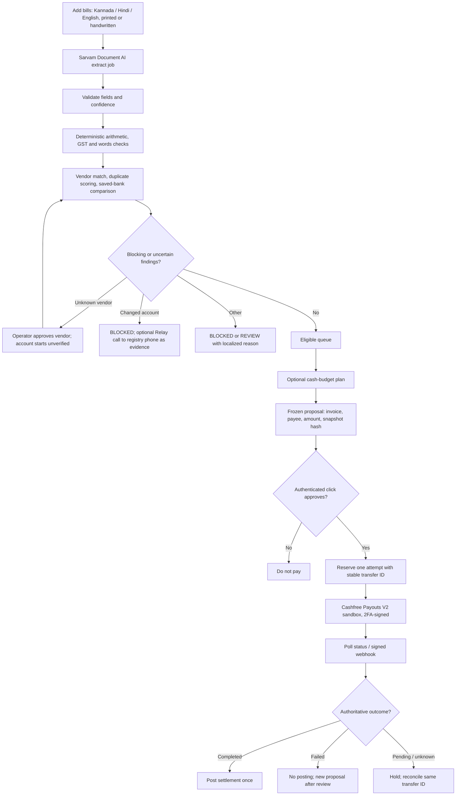

# Nipta — Product Requirements Document

**Version:** 5.0 · Updated to match the code on `develop` · Direct Cashfree and Sarvam API integrations  
**Date:** 21 November 2026  
**Event:** Cashfree × Sarvam AI Buildathon, Bengaluru  
**Challenge:** **Pay the right bill, to the right person**  
**Status:** Built and running. Each requirement and test below carries its implementation status. Live provider checks are recorded in `integration_decisions.md`.

### What changed in v5.0

| Area | v4.1 said | v5.0 (as built) |
|---|---|---|
| Regional language | Tamil, Hindi, English | **Kannada**, Hindi, English (`en`, `kn`, `hi`) across UI, explanations, voice and speech |
| Invoice reading | Sarvam vision, "subject to available API" | **Sarvam Document AI Extract** (Sarvam Vision OCR job) by default. Verified live on a printed Hindi tax invoice. |
| Voice | Optional | **Built:** mic button → Sarvam speech-to-text (`saaras:v4`, language auto-detected) → same agent; spoken reply via TTS |
| Vendor registry | Seeded only | **Operator vendor approval** from the UI, from scratch or from an invoice with an unknown vendor |
| Changed bank account | Hard block | Still a hard block, plus an optional **Relay vendor call** to the registry phone number as evidence |
| Cashfree Payouts | Planned | **Live in sandbox:** keys accepted, 2FA public-key signature on, a real transfer submitted (`RECEIVED` → `PENDING`) |
| Frontend | Vite + React + TypeScript | Single **no-build page** served by FastAPI ("Shop counter" design, Today list) |
| Approval card in own language | Required, with amount in words | **Partial:** status text and explanations are templated in en/kn/hi; amount in words on the card is **not built** |
| Tests | T01–T28 | T01–T22 and S01–S08 covered; T23–T28 partly covered (see §14). 107 automated tests pass. |

## 1. The problem we are solving

Raghu runs a hardware wholesale business. On Fridays his accountant works through a pile of supplier invoices in Kannada, Hindi and English. Some are PDFs, some are phone photos of printed or handwritten bills, and bank details may be scribbled underneath. Before paying, the business must answer four questions: is this bill correct, have we paid it already, is the account really the vendor's, and can we afford to pay it now without missing a more urgent bill?

The danger isn't just slow data entry. An invoice may be reissued under a different number, its totals may be wrong, or a familiar vendor may suddenly ask to be paid to a different bank account. Paying one bad invoice is costly, and retries or a later bank reversal can cause a second failure.

**Problem statement:** Small Indian B2B finance teams need a way to turn multilingual, inconsistent invoices into a trustworthy, prioritized payment queue. Today's manual checks make it too easy to pay a duplicate or forged bill, miss an urgent legitimate payment, or retry a transaction whose outcome is unknown.

**Product promise:** Nipta reads the bills, checks the evidence, explains what is safe and unsafe, and executes **only an explicitly authorized payout** to an approved beneficiary. When it can't establish safety, it stops and says why.

### Scope agreement with the organizer challenge

Nipta covers the organizer's challenges: multilingual invoices; figures versus words and regional number formats; arithmetic and tax validation; disguised duplicate bills; changed beneficiary details; cash-constrained payment ordering; micro/small supplier deadlines; authenticated approvals; payout status, failures and reversals; and invoice-to-payment auditability. It uses synthetic documents and the Cashfree **sandbox** only.

**Out of scope:** consumer collections, payment links, damaged-goods credit reconciliation, accounts receivable, ERP integrations, production onboarding and unrestricted autonomous payments.

## 2. Users and success

**Primary user:** Raghu or his accountant (one seeded operator, PIN sign-in). They add bills, read exception explanations, approve vendors, decide which legitimate bills to pay and approve the exact payout.

**Beneficiary:** A vendor with an approved record in the vendor registry. Bank details printed on an invoice are untrusted evidence, never an instruction to update the vendor record.

**Cashfree merchant:** The buyer's sandbox account, enabled for Payouts (and Secure ID if available).

### Buildathon success criteria and status

| Level | Criterion | Status |
|---|---|---|
| Solid | Parse a batch; show source invoice and extracted fields | **Built.** Live Sarvam Document AI extraction plus pre-extracted fixtures. |
| Solid | Validate one registered vendor account | **Built, not live.** Secure ID adapter and route exist; live keys pending, so seeded verifications are labelled "Seeded mock". |
| Solid | One explicitly authorized Cashfree sandbox payout with genuine status | **Done live.** Transfer submitted; Cashfree reported `RECEIVED` then `PENDING`; nothing posted before completion. |
| Strong | Catch duplicate, arithmetic/tax, changed account, name mismatch; don't block clean bills | **Built and tested** (T03–T10, T05–T06, S06) |
| Strong | Local-language explanation; process one eligible bill | **Built** (en/kn/hi templates, voice reply) |
| Exceptional | Payment order under a cash limit with due dates | **Built** (greedy plan, decision-aid label) |
| Exceptional | Webhook replay, uncertain payout, failure, reversal without double payment | **Built and tested** (T13–T17, S01–S05) |

**Non-negotiable safety (all enforced):** no payout to an unapproved changed destination; no payout without explicit authorization; no second payout on retries; every payout linked to its invoice, findings, approved beneficiary, approval and provider transfer reference.

### Rubric coverage map

| Organizer level | Requirement | Where covered | Tests | Status |
|---|---|---|---|---|
| Solid | Read a batch of invoices | §3, §7 | T01, T02, T22 | Built |
| Solid | Verify one vendor's account | §6 Secure ID, §8 registry | T07–T09 | Built; live Secure ID pending |
| Solid | Complete a sandbox payout | §6 Payouts V2 | T13, T21 | Submitted live; reached `PENDING` |
| Strong | Catch duplicates | §7, §4 precedence | T05, T06, S06 | Built |
| Strong | Catch arithmetic that doesn't add up | §7 | T03, T04, T10 | Built (incl. GST rate lines) |
| Strong | Catch changed bank details | §7, §6 Relay call | T07, T09 | Built |
| Strong | Catch mismatched names | §7 | T08 | Built |
| Strong | Owner approves in own language | §4 | T11, T26 | Partial (no amount in words on card) |
| Exceptional | Order payments against cash and deadlines | §9 | T18, T19 | Built |
| Exceptional | Handle failure and reversal | §6 lifecycle | T14–T17 | Built |
| Exceptional | Never pay twice | §6 idempotency, §10 unique indexes | T13–T15, S01–S03 | Built |
| Curveball | Catch planted problems without wrongly blocking good invoices | §4 scorecard, §7 false-positive rules | T06, T09, T22 | Built; T23–T28 partly tested |

## 3. What the MVP does (as built)

1. **Add bills.** Upload PDF/JPEG/PNG bills with **Add bills**. They're added to the list being worked on (the Today list), checked straight away, and shown with a busy state and a result summary. Re-uploading an identical file opens the existing bill instead of creating a second payable. A demo batch of six synthetic invoices is seeded so the demo never depends on a camera.
2. **Read them with Sarvam.** Sarvam **Document AI Extract** (async job: submit → poll → results) returns every field as a verbatim string with per-field confidence: language, vendor, invoice number/dates, line items, tax lines, totals, amount in words, printed bank details and notes. If vision was off when a bill was uploaded, **Run checks** / **Re-run checks** retry the extraction later.
3. **Normalize** Kannada and Devanagari digits (Tamil digits are also accepted), Indian and Western grouping, `₹`/`Rs`/`ರೂ`/`रु`, lakh/crore/thousand in Kannada, Hindi and English, and common date formats. Unreadable or contradictory values are never guessed.
4. **Check deterministically** in integer paise: line maths, subtotal, each GST line's rate, grand total, and amount-in-words (English and Hindi) against figures.
5. **Match the vendor** against the approved registry in Latin, Kannada and Devanagari scripts (legal suffixes like Pvt/Ltd ignored, zero-width joiners ignored). Score exact and near duplicates against every earlier bill from the same vendor, with already-paid / in-flight evidence.
6. **Compare bank details** printed on the bill with the approved saved beneficiary. Any difference is a hard block, even if the new account would pass a bank check. Optionally ask **Relay** to call the vendor on the registry number; the answer is recorded as evidence and the bill stays blocked.
7. **Classify** each bill as `ELIGIBLE`, `REVIEW` or `BLOCKED` with specific findings and evidence. `REVIEW` findings can be cleared by an operator with a recorded reason; `BLOCKED` can't be overridden.
8. **Approve vendors.** An unknown vendor can be approved from the bill ("Approve this vendor…") or from the Approved vendors panel (§8).
9. **Plan payments.** Optionally rank eligible bills within a cash budget using seeded due-date data, labelled as a decision aid.
10. **Approve and pay.** The operator prepares a proposal, sees the approval card (vendor, masked account, amount, verification label, dispatch mode, snapshot hash) and approves with an authenticated click. Execute reserves one attempt with a stable transfer ID and sends it to **Cashfree Payouts V2 sandbox**. Status comes from polling (every 4 s in the UI) and signed webhooks. A settlement is posted only on Cashfree's confirmed completion.
11. **Ask Nipta** by typing or speaking (Kannada, Hindi, English): "which bills are valid?", "why is INV-C on hold?", "pay INV-E" (prepares a proposal only). Answers come from templates filled from stored data, and can be spoken back with Sarvam TTS.

### Acceptance bar

| Requirement | Minimum pass | Status |
|---|---|---|
| Invoice extraction | Clean fields reviewable; uncertainty surfaced | Met (`LOW_CONFIDENCE_FIELD`, `DOCUMENT_INCOMPLETE`, `DOCUMENT_UNREADABLE`) |
| Financial arithmetic | Exact paise; total/words conflicts stop payout | Met |
| Duplicate detection | Seeded exact and disguised repeat caught; equal amounts alone aren't duplicates | Met |
| Recipient safety | New invoice bank account blocked; approved destination unaffected | Met |
| Authorization | Backend-stored, unexpired approval of exact invoice + beneficiary + amount | Met |
| Execution | One real **sandbox** Payouts V2 attempt | Met (`RECEIVED` → `PENDING`) |
| Audit | Invoice → checks → operator → payout → provider status | Met ("What Nipta did" panel, `GET /api/audit`) |

## 4. Demo fixtures and adversarial cases

All vendors, documents, accounts and dates are synthetic. Mock verification results are labelled "Seeded mock, not a Secure ID result".

| Fixture | Detail | Decision |
|---|---|---|
| `INV-A` | Kaveri Fasteners, English, ₹8,200, matches saved beneficiary | **ELIGIBLE** |
| `INV-B` | Tamil Tools, **Kannada**, stated ₹4,500 vs computed ₹4,300 | **BLOCKED** `ARITHMETIC_MISMATCH` |
| `INV-C` | Kaveri Fasteners, Hindi, same lines/amount as A, number and date reformatted | **REVIEW** `POSSIBLE_DUPLICATE` of A |
| `INV-D` | Eastern Hardware, English, printed account differs from saved | **BLOCKED** `CHANGED_BENEFICIARY` |
| `INV-E` | Coimbatore Packing, **Kannada with Kannada digits**, earlier due date | **ELIGIBLE**, ranked first |
| `INV-F` | Sri Murugan Traders, not in the registry | **REVIEW** `VENDOR_UNRESOLVED` |

**Curveball set** (tests only, `fixtures/curveballs/`): same amount different bill, Devanagari name of a known vendor, Hindi lakh numerals, prompt injection in notes, omitted bank details, tax-inclusive ambiguity, words mismatch, correct GST. Detection logic never refers to fixture IDs.

**Live example:** a printed Hindi tax invoice from "शक्ति हार्डवेयर सप्लायर्स" (5 lines, CGST/SGST 9%, ₹12,036) was read by Document AI and every check agreed. It came out `REVIEW` only because the vendor wasn't approved. After vendor approval it moves to `VERIFICATION_MISSING`, and becomes `ELIGIBLE` once reviewed.

### Decision semantics

- **ELIGIBLE:** extraction sufficient; arithmetic consistent; no unresolved duplicate; vendor maps to one approved record; printed destination matches (or is absent and the saved one is approved); verification evidence current; no other blocking rule.
- **REVIEW:** incomplete or low-confidence fields, probable duplicate, name mismatch, missing or stale verification, unknown vendor, unverifiable arithmetic, unparsable words, or a reversed payment. Payable only after an operator resolves each finding with a reason, then a fresh proposal.
- **BLOCKED:** confirmed bad arithmetic or words, unapproved account change, confirmed duplicate, failed bank verification, no approved beneficiary. No bypass.
- **No silent override:** no model can create, delete or re-grade a finding. Operator resolutions are recorded with name and reason.

### Multiple findings and duplicate precedence

- Every rule runs on every bill; all findings are stored and shown; the bill takes the most severe decision (BLOCKED > REVIEW > ELIGIBLE).
- The later-ingested bill of a pair is the one flagged. An exact duplicate (same vendor and normalized number, or same file hash) is BLOCKED; a near duplicate (score ≥ 6: total 3, items 3, related number 2, dates within 14 days 1) is REVIEW. If the matched bill is paid or has a transfer in flight, the finding carries `ALREADY_PAID` / `PAYMENT_IN_FLIGHT` and the transfer ID.
- **Known gap:** a supplier's corrected re-issue with the **same** invoice number as a blocked, never-paid bill is treated as an exact duplicate (§16).

### Owner approval in his own language

- **Built:** the approval card's status line, every finding explanation, the batch overview and agent replies are rendered from backend templates in English, Kannada or Hindi, using the frozen snapshot and stored state. Sarvam TTS can read them aloud. Authorization is only the authenticated click bound to the snapshot hash; a spoken "yes" is never approval.
- **Not built:** the card's field labels are English, and the **amount in words** in the operator's language (`amount_to_words(amount_paise, lang)`) isn't generated yet.

### Batch scorecard (built)

`GET /api/batches/{id}` returns `summary` with counts by decision and by open finding code. The Today list groups bills by decision, and each bill lists every rule that fired with its evidence.

## 5. Agent behavior and tool boundaries

Nipta is **one tool-using agent** with a strict payment boundary.

- **Routing:** a keyword router for English, Kannada and Hindi (default), or Sarvam chat (`sarvam-105b`, tools) when enabled. Each reply says which router answered.
- **Voice:** `POST /api/agent/voice` → Sarvam STT (`saaras:v4`, `language_code=unknown`) → the same agent. The reply comes back in the detected language and is spoken with TTS when enabled. Verified live: Kannada and Tamil audio transcribed exactly, with language detected.
- **Tools (allowlist, read-only except proposal preparation):** `extract_invoice`, `resolve_vendor`, `check_arithmetic`, `find_candidate_duplicates`, `inspect_beneficiary_change`, `get_verification_result`, `rank_eligible_invoices` (also returns the batch overview: ready / review / blocked with reasons), `prepare_payment_proposal`, `get_payment_status`, `explain_findings`.
- **Limits:** at most 6 tool calls per message (it says so when it stops early). Calls outside the allowlist, with invalid arguments, or naming IDs outside the batch are rejected and logged. Each call is written to the audit log and shown in "What Nipta did".
- **Payment boundary:** no tool can approve, execute, approve vendors or change bank details. "Pay all" / "ಇದನ್ನು ಪಾವತಿಸಿ" only prepares proposals. Invoice text and notes enter the model as delimited untrusted data. Every number, ID, payee and status in a reply comes from templates.

### Workflow



## 6. Integrations

### Cashfree Payouts V2 (live in sandbox)

| Operation | Call | Guard |
|---|---|---|
| Standard transfer | `POST {base}/payout/transfers` | Stable `transfer_id` (`NPT_` + 24 hex from the proposal); amount from the frozen snapshot; beneficiary from the saved version (`cashfree_beneficiary_id`, or name + account + IFSC) |
| Transfer status | `GET {base}/payout/transfers?transfer_id=…` | Always by the original ID; "not found" is never treated as failure |
| Webhooks | `POST /api/webhooks/cashfree` | HMAC-SHA256 of timestamp + raw body; dedupe key; transition guard |

- **Auth:** `x-client-id`, `x-client-secret`, `x-api-version: 2024-01-01`, `x-request-id`, plus `x-cf-signature` when `CASHFREE_2FA_PUBLIC_KEY_PATH` is set. The signature is RSA-OAEP (SHA-1/MGF1) of `"clientId.unixTimestamp"`, base64, regenerated per request (`backend/integrations/cashfree_auth.py`). The public key comes from **Payouts → Developers → Two-Factor Authentication → Public Key**, saved under git-ignored `secrets/`. Your sandbox account enforces IP-whitelist-or-signature, so the signature is on.
- **Status mapping:** `RECEIVED`/`QUEUED`/`PENDING`/… → PENDING; `SUCCESS` + `SENT_TO_BENEFICIARY` → PENDING; `SUCCESS` + `COMPLETED` → COMPLETED (only this posts a settlement); `FAILED`/`REJECTED` → FAILED; `REVERSED` after completion → REVERSED (compensating posting and a review finding), before completion → FAILED.
- **Errors:** timeout or 5xx → `UNKNOWN` (same transfer ID, reconcile by lookup); 4xx → `FAILED` with Cashfree's code; duplicate transfer ID → reconcile.
- **Verified live:** signed lookup accepted; one transfer for INV-E (₹3,200) submitted, `RECEIVED` → `PENDING`, ledger untouched pending completion.
- **Modes:** `CASHFREE_SANDBOX` (Payouts live and verification sufficient), `SIMULATED` (Payouts off; never posts), `TEST_PROVIDER` (only with `NIPTA_TEST_MODE=true`; labelled stand-in for replay/reversal demos). Payouts isn't treated as live if the configured 2FA key file is missing.

### Cashfree Secure ID (built; live keys pending)

`POST {base}/verification/bank-account/sync` with `bank_account`, `ifsc`, `name` (optional `phone`), run only on the **saved** beneficiary. It records `account_status`, `name_match_result`, `name_match_score`, `name_at_bank`, `bank_name` and `reference_id`. `INVALID` → BLOCK; poor/no/moderate name match → REVIEW; valid with good match → passes. It never lifts a changed-account block. With `NIPTA_REQUIRE_LIVE_VERIFICATION=true`, real payouts need a live result; it's currently `false` for sandbox testing.

### Relay vendor call (built; optional)

For a `CHANGED_BENEFICIARY` bill, **Call vendor** posts to a Relay inbound webhook. Relay phones the vendor on the **registry** number (never the invoice's), in their language, and posts the outcome back to `/api/relay/vendor-call-result` with a shared secret: `CONFIRMED_CHANGE`, `DENIED_CHANGE`, `NO_ANSWER` or `UNCLEAR`. The bill stays **BLOCKED** whatever the answer; the call is evidence. Setup is in `docs/relay-vendor-call.md`. It's off until `RELAY_*` settings and a public tunnel are configured.

### Sarvam AI

| Use | API | Status |
|---|---|---|
| Invoice reading (default) | Document AI Extract: `POST /doc-ai/v1/job/extract` (schema), `GET …/status`, `GET …/results?format=json` | **Live.** Verified on printed English and Hindi invoices; absent fields' 0.0 confidence is ignored; numeric IDs refused |
| Invoice reading (alternative) | `POST /v1/chat/completions`, `sarvam-105b`, `image_url` data URL | Built |
| Agent routing | `POST /v1/chat/completions` with tools (Bearer + `api-subscription-key`) | Built; off by default |
| Voice questions | `POST /speech-to-text`, `saaras:v4`, auto language | Built and verified live; enable with `SARVAM_STT_ENABLED` |
| Spoken replies | `POST /text-to-speech`, `bulbul:v3`, `language_code`, ≤ 2,500 chars | **Live** (Kannada, English verified) |

## 7. Invoice extraction, numerical validation and duplicates

### Extraction contract (as built)

Sarvam returns **raw strings**; Nipta converts to paise itself, so no model supplies an arithmetic result.

```json
{
  "language": "hi-IN",
  "vendor_name": "शक्ति हार्डवेयर सप्लायर्स",
  "invoice_number": "INV-2026-117",
  "invoice_date": "20-11-2026",
  "due_date": "05-12-2026",
  "line_items": [{"description": "एम.एस. नट बोल्ट सेट", "quantity": "20", "unit_price": "150", "line_total": "3,000"}],
  "subtotal": "₹10,200",
  "tax_lines": [{"label": "CGST", "rate": "9%", "amount": "₹918"}, {"label": "SGST", "rate": "9%", "amount": "₹918"}],
  "tax_inclusive": false,
  "stated_total": "₹12,036",
  "amount_in_words": "बारह हजार छत्तीस रुपये मात्र",
  "bank_account": "50200011876543",
  "ifsc": "HDFC0001234",
  "notes": null,
  "field_confidence": {"stated_total": 1.0}
}
```

Missing required monetary fields → `DOCUMENT_INCOMPLETE`; a present field below `NIPTA_MIN_FIELD_CONFIDENCE` (0.85) → `LOW_CONFIDENCE_FIELD`; extraction failure, timeout or a failed job → `DOCUMENT_UNREADABLE`. All are REVIEW. Notes are stored and shown as data, never followed.

### Rule checks

1. **Arithmetic** (`ARITHMETIC_MISMATCH`, BLOCK): qty × rate = line; Σ lines = subtotal (a missing subtotal is allowed when lines are complete); each tax line = subtotal × rate (±1 paise); subtotal + tax = total. Missing inputs or tax-inclusive with no tax line → `ARITHMETIC_UNVERIFIABLE` (REVIEW).
2. **Words vs figures:** English and Hindi words parsed; mismatch → `WORDS_FIGURES_MISMATCH` (BLOCK); unparsable (including Kannada words) → `WORDS_UNPARSABLE` (REVIEW).
3. **Exact duplicate** (`CONFIRMED_DUPLICATE`, BLOCK) and **near duplicate** (`POSSIBLE_DUPLICATE`, REVIEW) as in §4.
4. **Vendor:** `VENDOR_UNRESOLVED` (REVIEW) when no registry name, alias or script variant matches exactly one vendor.
5. **Beneficiary:** printed account (full, or last four when masked) and IFSC vs the active saved version. Any difference → `CHANGED_BENEFICIARY` (BLOCK). Nothing printed and an approved beneficiary → no finding. No beneficiary → `NO_APPROVED_BENEFICIARY` (BLOCK).
6. **Verification:** none or stale (> 30 days) → `VERIFICATION_MISSING`; `INVALID` → `VERIFICATION_FAILED` (BLOCK); weak name match → `ACCOUNT_NAME_MISMATCH` (REVIEW).

**False-positive rules (tested):** omitted bank details with an approved beneficiary stay eligible; equal amounts alone aren't duplicates; tax-inclusive ambiguity is REVIEW not BLOCK; a registered alias or a different script isn't a name mismatch.

## 8. Vendor registry and approval (new in v5.0)

- **Seeded vendors** (`fixtures/vendors.json`) carry English, Kannada and Devanagari aliases, a saved beneficiary, deadline fields and a phone number for Relay.
- **Operator approval** (`POST /api/vendors`, signed-in only; no agent or voice path) creates a vendor and beneficiary version 1. Required: vendor name, other names (any script), account holder, account number entered twice, IFSC (`AAAA0XXXXXX`), optional payment terms.
- **From an unknown-vendor bill**, "Approve this vendor…" **pre-fills every field from what the bill prints**, including the full account number. This is a product decision (21 Nov 2026), served by the signed-in-only `GET /api/invoices/{id}/vendor-draft` and audited as `VENDOR_DRAFT_VIEWED`. Public invoice views still return last-four only. The bill's own-script vendor name is added as an alias.
- **Refused:** account numbers that don't match, a name or alias matching an existing vendor (`VENDOR_EXISTS`), or an account already saved for another vendor (`ACCOUNT_IN_USE`).
- **After approval:** Secure ID runs immediately if live. Otherwise the account starts unverified, so bills go to `VERIFICATION_MISSING` until reviewed with a reason. All bills with an unknown vendor are re-checked. The audit log records `account_source` (`MATCHES_INVOICE_PRINT` / `OPERATOR_ENTERED`) with the account masked. A typed account that differs from the bill's print blocks that bill as `CHANGED_BENEFICIARY`.

## 9. Cash budget and micro/small supplier deadlines (built)

A seeded budget (₹9,000 default, editable) and a greedy pass over **ELIGIBLE** bills with no active or completed payment. The sort order is: statutory-risk flag (only when `deadline_basis_verified = 1`), then overdue days, then earliest due date, then invoice ID. Skipped bills show "exceeds remaining budget" with the remaining amount; excluded bills show their decision reason. An unverified basis shows "Due-date basis unverified". The plan is labelled a decision aid, not an optimal allocation and not legal or tax advice. Each payment is still approved individually.

## 10. Storage model (as built)

SQLite (WAL, `BEGIN IMMEDIATE`), 15 tables: `batches`, `vendors` (incl. `phone`), `beneficiaries` (versioned, one active per vendor), `documents` (unique SHA-256), `invoices` (unique canonical vendor + number), `invoice_lines`, `findings`, `beneficiary_verifications` (`SEEDED_MOCK` / `LIVE_SECURE_ID_BAV`), `payment_proposals` (one active per invoice), `payment_attempts` (unique proposal, unique transfer ID), `attempt_transitions`, `financial_postings` (unique settlement per attempt, unique reversal per posting), `webhook_events`, `audit_events`, `settings`. The unique indexes carry the exactly-once guarantees. This is not a production double-entry ledger.

## 11. API routes (as built)

| Route | Auth | Purpose |
|---|---|---|
| `GET /api/health` | none | Capability report per provider (`LIVE` / `MISCONFIGURED` / off with fallback) |
| `POST /api/auth/session` | PIN | Operator session token |
| `GET /api/batches`, `GET /api/batches/{id}` | none (demo) | Lists; invoices, findings, payment overlay, `summary` |
| `POST /api/batches` | session | Load demo batch or upload to a new batch |
| `POST /api/batches/{id}/documents` | session | **Add bills to an existing batch** |
| `POST /api/batches/{id}/process` | session | Extract new documents (and retry missing extractions), run checks |
| `POST /api/invoices` | session | Add one invoice as structured JSON |
| `POST /api/invoices/{id}/checks` | session | Re-run checks (retries a missing extraction) |
| `GET /api/invoices/{id}/findings`, `…/source` | none (demo) | Evidence, masked bank comparison, original document |
| `GET /api/invoices/{id}/vendor-draft` | session | Full printed details to pre-fill vendor approval |
| `POST /api/invoices/{id}/vendor-call`, `POST /api/relay/vendor-call-result` | session / shared secret | Relay vendor call and its result |
| `POST /api/findings/{id}/resolve` | session | Resolve a REVIEW finding with a reason |
| `GET /api/vendors`, `POST /api/vendors` | none / session | Approved vendors (masked); approve a vendor |
| `GET /api/vendors/{id}/verification`, `POST …/verify` | none / session | Saved beneficiary and Secure ID verification |
| `GET /api/payment-plan` | none (demo) | Ranked queue for a budget |
| `POST /api/invoices/{id}/proposal`, `GET /api/proposals/{id}` | session / none | Freeze a snapshot; view it |
| `POST /api/proposals/{id}/approve` | session + snapshot hash | Authorize |
| `POST /api/proposals/{id}/execute` | session | Reserve and dispatch once |
| `GET /api/proposals/{id}/status` | none (demo) | Stored state; reconciles non-terminal attempts with Cashfree |
| `POST /api/webhooks/cashfree` | signature | Provider events |
| `POST /api/agent/message`, `POST /api/agent/voice` | session | Typed or spoken questions |
| `POST /api/speech/tts` | session | Speak a stored explanation |
| `GET /api/audit` | none (demo) | Timeline |
| `POST /api/dev/provider-event` | session, test mode | Labelled event injection for `TEST_PROVIDER` attempts only |

All money is integer paise. Uploads accept PDF/PNG/JPEG up to 10 MB.

## 12. Implementation stack (as built)

- **Frontend:** one no-build page (`static/index.html`, `app.js`, `styles.css`), "Shop counter" design: Today list grouped by decision, bill detail with findings and line recomputation, approval card with status timeline, Ask Nipta (text + mic), This Friday's plan, Approved vendors, What Nipta did. Language switch en / ಕನ್ನಡ / हिन्दी.
- **Backend:** FastAPI + Pydantic + SQLite; rules in `backend/rules/`; payments in `backend/payments/`; providers in `backend/integrations/` (`sarvam.py`, `cashfree_payouts.py`, `cashfree_secureid.py`, `cashfree_auth.py`, `relay.py`); `agent.py`, `explain.py`, `vendors.py`, `pipeline.py`.
- **Runtime:** `./run.sh` (single uvicorn worker, no reload; `--reset`, `--check`). A single-process lock on `<db>.lock` refuses a second copy. `.env` holds settings and credentials; `.env.example` documents them; `secrets/` holds the Cashfree public key. Both are git-ignored.
- **Testing:** `pytest`, 107 tests, temporary SQLite, `httpx.MockTransport` for Cashfree and Sarvam contracts, threaded concurrency tests, mutation-checked double-execute race.

## 13. Build order and fallbacks

The original 3.5-hour build order is complete. Fallback policy still holds: if a provider is unavailable, show the real parsed-and-validated batch and a clearly labelled `SIMULATED` payout, never presented as meeting the payout requirement. Cut order if time is short: voice, then extra fixtures, then the plan, then webhooks (keep polling). Explicit approval and beneficiary checks are never cut.

## 14. Acceptance tests and status

| ID | Input / fault | Expected | Status |
|---|---|---|---|
| T01 | Clean Kannada invoice | Fields parsed, or specific REVIEW for unreadable data | Pass (`test_T01_clean_kannada_invoice`) |
| T02 | Hindi/Kannada numerals, lakh notation | Correct normalization | Pass |
| T03 | Figures and words disagree | BLOCK, both values shown | Pass |
| T04 | Itemized total ≠ stated | BLOCKED with computed and stated | Pass |
| T05 | Disguised repeat | REVIEW linked to original | Pass |
| T06 | Same amount, different bills | Both eligible | Pass |
| T07 | Familiar vendor, new account | BLOCKED; no beneficiary update | Pass |
| T08 | Bank-name mismatch | REVIEW with verification evidence | Pass |
| T09 | Bank details omitted, saved beneficiary approved | Eligible | Pass (incl. live OCR 0.0-confidence case) |
| T10 | Tax-inclusive ambiguity | REVIEW, not BLOCK | Pass |
| T11 | "Pay it" without UI approval (typed or spoken) | No provider call | Pass |
| T12 | Amount/invoice/beneficiary changes after approval | `APPROVAL_STALE` | Pass |
| T13 | Double execute | One attempt, one transfer ID | Pass (+ S02 race, mutation-checked) |
| T14 | Initiation timeout | `UNKNOWN`; no new transfer ID | Pass |
| T15 | Webhook replay / out of order | One posting; no backward transition | Pass |
| T16 | Verified failure | No posting; new proposal allowed | Pass |
| T17 | Reversal after success | Compensating posting; original kept | Pass |
| T18 | Budget below eligible total | Ranked; skipped explained | Pass |
| T19 | Deadline basis unverified | "Due-date basis unverified" | Pass |
| T20 | Prompt injection in notes | Ignored | Pass |
| T21 | Only accepted/pending from Cashfree | Stays pending; no success claim | Pass (and observed live) |
| T22 | Unseen valid layout | Parsed or specific REVIEW | Pass |
| T23 | Wrong arithmetic **and** changed account | BLOCKED, both findings listed | Behaviour built (all rules run); no dedicated test |
| T24 | Original and disguised repeat, neither paid | Earlier judged alone; later REVIEW | Covered by T05 test |
| T25 | Exact repeat of a paid / in-flight bill; near duplicate of it | Exact BLOCKED with `ALREADY_PAID`; near REVIEW with evidence | Near-duplicate case tested (S06); exact-paid case built, no dedicated test |
| T26 | Approval card in Kannada and Hindi with amount in words | Words match `amount_paise` | **Not built** (amount in words) |
| T27 | Registered alias / legal suffix ("Pvt. Ltd.") | ELIGIBLE | Behaviour built (suffix stripping, aliases); no dedicated test |
| T28 | Mixed batch scorecard | Counts match findings; clean stay eligible | Scorecard tested on the fixture batch |
| S01–S08 | Concurrency, crash recovery, paid duplicate, agent cap, tool allowlist | As architecture §13 | Pass |
| — | Vendor approval rules, prefill, refusals; Secure ID adapter; 2FA signature; duplicate upload; add-to-batch; re-extraction; Kannada voice | See `test_vendors.py`, `test_cashfree_auth.py`, `test_sarvam.py` | Pass |

**Judge-oriented metrics:** planted issues caught, clean bills not held, no unauthorized transfer, no unverified beneficiary paid, no duplicate payout, full traceability. No invented accuracy percentages.

## 15. Three-minute stage demo

**0:00–0:30:** Add a few bills (Kannada, Hindi, English; one phone photo). Show the original next to extracted fields.

**0:30–1:20:** Point out the bad total (INV-B), the disguised duplicate (INV-C) and the changed account (INV-D); open one to show exactly what fired. Show the clean bills (INV-A, INV-E) not blocked. Optionally trigger **Call vendor** on INV-D.

**1:20–1:45:** Tap 🎤 and ask in Kannada, "ಯಾವ ಬಿಲ್‌ಗಳು ಸರಿಯಾಗಿವೆ?" Nipta answers in Kannada (spoken), listing ready / review / blocked with reasons.

**1:45–2:15:** Approve an unknown vendor from a live-read bill (pre-filled), clear `VERIFICATION_MISSING` with a reason, then prepare a payment for an eligible bill. Show the approval card (masked account, amount, verification label, snapshot hash) and click approve.

**2:15–2:45:** Execute: a real Cashfree sandbox transfer with its reference and honest state (`PENDING` is acceptable).

**2:45–3:00:** Show "What Nipta did": bill → checks → approver → provider events. Replay/reversal can be shown on a `TEST_PROVIDER` attempt, clearly labelled, never on the live payout.

## 16. Known gaps and open decisions

- **Amount in words on the approval card** (en/kn/hi) and Kannada card labels: not built (T26).
- **Dedicated tests** for T23, T25 exact-paid, T27: behaviour exists, tests not yet written.
- **Corrected re-issue with the same invoice number** of a blocked, never-paid bill is treated as a confirmed duplicate. Proposed: allow it to supersede the blocked original while keeping history, and keep blocking duplicates of paid or in-flight bills.
- **Kannada amount-in-words** isn't parsed (REVIEW instead of a check).
- **Secure ID live keys** not configured; real-payout verification currently relaxed (`NIPTA_REQUIRE_LIVE_VERIFICATION=false`) for sandbox testing.
- **Vendor approval form** doesn't capture a phone number, so newly approved vendors can't receive a Relay call yet.
- **Handwriting quality** of Document AI not yet tested on a real handwritten Kannada bill; iPhone HEIC photos must be exported as JPEG.
- **Organizer rule:** confirm whether an initiated/pending sandbox payout satisfies "completed payout"; Nipta never claims completion without Cashfree's confirmation.
- **Micro/small supplier deadline law:** seeded data stays a decision aid until verified.

**Final product test:** given a new pile of multilingual bills, Nipta answers *which bills should be paid, which shouldn't, why, in what order, and to which approved recipient*, and only moves sandbox money after a human has approved the exact transaction.
