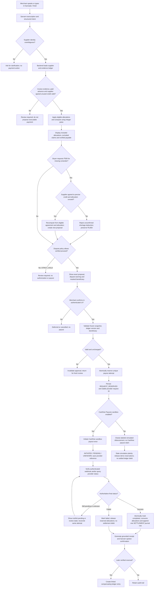

# NIPTA — PRODUCT REQUIREMENTS DOCUMENT (PRD)

**Product:** Nipta — Evidence-Backed Vernacular B2B Settlement Agent  
**Version:** 2.7 (Nipta buildathon branding; payment reservation, journal effects, API contracts, and evidence provenance aligned)  
**Date:** 20 November 2026  
**Event:** Cashfree × Sarvam AI Buildathon, Bengaluru — 21 November 2026  
**Team:** 5 builders; 3.5-hour build sprint (12:30–4:00 PM)  
**Source of truth:** `problemstatement.txt` v2.3 (commercial approval and allocation rules aligned)  
**Integration confidence:** Cashfree API paths, payloads, authentication, webhook event names and sandbox access **not independently verified**. Confirm against the enabled product's current documentation and event engineers before implementation.

## 1. Product definition

**Positioning:** Not voice-controlled payments. **Evidence-backed supplier settlement in the language merchants already use.**

Nipta helps Bengaluru restaurant, bakery, cloud-kitchen and fresh-produce retail owner-operators reconcile fragmented supplier records, explain approved versus disputed adjustments, and request a human-authorized supplier payout. Kannada is the primary demonstration language; Hindi/Hinglish is secondary. The first release uses curated demo records, not live WhatsApp or document ingestion.

**User job:** “When I need to clear a supplier's balance, identify the actual amount due from trustworthy records, show me what is disputed, and let me authorize payment without guessing or paying twice.”

**Product outcome:** A buyer can understand *why* ₹6,850 is payable, refuse an unsupported ₹500 deduction, decide whether to proceed under the merchant's dispute policy, and see an honestly reported Cashfree payout state if Payouts sandbox access exists.

### Buyer and supplier roles

- **Buyer (Nipta user):** The restaurant, bakery, cloud kitchen, or produce retailer that **receives** goods and **owes** payment. In this document, *merchant* means this buyer operating Nipta, unless explicitly referring to a Cashfree merchant account.
- **Supplier (payee):** **Ramesh Vegetables**, which **delivers** produce, issues the invoice, acknowledges valid credits, and **receives** the buyer's payout.
- **Cashfree merchant:** The legal/API account holder authorized to use Cashfree; this platform term is distinct from Nipta's buyer/supplier roles. Do not assume the buyer's Cashfree Payouts access is enabled.
- **Credit:** A supplier-agreed reduction in the buyer's payable that is eligible only after evidence and allocation checks. **Disputed claim:** A buyer-requested reduction lacking supplier agreement; it is displayed but not deducted. An internal buyer approval or a mere supplier acknowledgment of receiving a complaint is **not** supplier agreement to a specific credit amount.

The ₹500 scenario concerns **missing coriander in a produce delivery**, not returnable packaging or deposits.

## 2. Strict boundaries

| Responsibility | Component | Non-negotiable rule |
|---|---|---|
| Audio transcription and spoken responses | Sarvam AI speech services | Speech is a user-input/output channel, **not** financial evidence or authorization. |
| Structured intent classification | Sarvam-supported language model where available | Output is untrusted; validate against schema and resolve supplier from merchant-owned data. |
| Amount computation and record eligibility | Deterministic backend | Integer paise arithmetic; require source evidence, the appropriate counterparty agreement, and unused invoice allocation before applying any adjustment. |
| Dispute decisions | Configured merchant policy + explicit merchant choice | No spoken instruction may approve an unapproved credit or change policy. |
| Approval | Authenticated application backend + UI | Exact snapshot approval, short expiry, one-time use. Voice alone cannot approve money movement. |
| Payment execution and state | Cashfree adapter + backend state machine | Only after valid authorization; a successful HTTP response is not proof of completed transfer. |
| Authoritative spoken confirmation | Backend status → fixed language template → Sarvam TTS | Never synthesize a success claim from an unverified request. |

## 3. Seeded evidence and example

**Supplier:** Ramesh Vegetables, Bengaluru (`SUP-001`). All values below are *seeded demonstration data*, not evidence automatically extracted from live records.

| Record ID | Type | Description | Signed amount | Ledger state | Evidence label |
|---|---|---|---:|---|---|
| `INV-104` | Invoice | Produce delivery, 19 Nov | +₹8,200 | `ISSUED`, buyer-accepted | `PDF_BILL`; linked to supplier `SUP-001` |
| `ADV-019` | Advance | Prior UPI payment, 17 Nov | −₹1,000 | `PAYMENT_CONFIRMED`, linked to `INV-104`, `UNAPPLIED` | `UPI_REF` (seeded reference); unused balance ₹1,000 before this allocation |
| `CRD-007` | Credit | Damaged tomatoes | −₹350 | `SUPPLIER_APPROVED`, linked to `INV-104`, `UNAPPLIED` | `WHATSAPP_NOTE` (seeded explicit supplier agreement to ₹350); unused credit ₹350 before this allocation |
| `CLM-012` | Claim | Short delivery: ₹500 of coriander reportedly missing | −₹500 | `DISPUTED`, not supplier-approved | Buyer-reported shortage; no supplier-approved ₹500 credit |

**Verified payable:** `₹8,200 − ₹1,000 − ₹350 = ₹6,850`.  
**Excluded open claim:** `CLM-012`, −₹500. The buyer alleges ₹500 worth of coriander was missing from the delivery; Ramesh has **not** acknowledged the shortage or issued a credit. Consequently, this claim does **not** reduce the verified payable to ₹6,350. Explicit supplier agreement to the precise credit amount, a documented credit record and unused allocation would be required before a later recomputation (resolution is out of MVP scope).

### Dispute policy

- **`ALLOW_VERIFIED_PROCEED` (demo default):** Keep `CLM-012` open; reject any attempt to deduct it; offer an explicit choice between proceeding with the verified ₹6,850 and deferring payment.
- **`STRICT_HOLD`:** Any designated material unresolved claim blocks payout until resolved. Show the verified *calculation* but no executable approval button.
- **Policy integrity:** Show the active policy in the UI as a read-only badge. For demo comparisons, a separately authenticated operator-only settings action may switch policy; changing policy invalidates existing proposals and approvals. The model cannot toggle it.

**Important distinction:** A mathematically verified payable is not automatically an authorization to settle; the buyer knowingly decides whether to proceed under the active policy. Paying ₹6,850 leaves the buyer’s disputed ₹500 short-delivery claim **open**, without treating the supplier as having accepted or resolved it.

## 4. MVP user journey

1. Merchant uses browser mic or text to request, in Kannada, “Clear Ramesh Vegetables' balance.”
2. Sarvam transcribes; a strict parser yields an intent and supplier alias, not authoritative account data.
3. Backend resolves `SUP-001`, fetches four seeded records, verifies the invoice association, confirms that the advance was actually paid and not previously consumed, checks explicit supplier agreement and unused allocation for the ₹350 credit, then computes ₹6,850.
4. Evidence ledger displays three eligible records, one excluded disputed claim, and the current policy.
5. Buyer says, “Deduct ₹500 for the coriander Ramesh did not deliver.” Backend refuses because `CLM-012` is a **buyer-reported, supplier-unapproved short-delivery claim**; it does not mutate the ledger and explains this in Kannada/Hindi.
6. If policy permits, merchant selects **Proceed with verified ₹6,850**, inspects masked beneficiary details and an immutable authorization snapshot, then explicitly confirms through the authenticated UI.
7. Backend validates approval, current ledger version, expiry, beneficiary, currency and amount; atomically reserves eligible allocations and exactly one payout attempt in internal `REQUEST_RESERVED` before calling the confirmed Cashfree sandbox Payouts API if enabled. An uncertain dispatch stays `UNKNOWN`, with no new transfer identifier.
8. Backend verifies status through authenticated callbacks and/or Cashfree status lookup. It posts settlement once only after authoritative success. Unknown or pending status is shown honestly.
9. Sarvam TTS reads a templated status from stored backend truth, with the exact amount and reference.

## 4A. End-to-end workflow flowchart

The diagram below is the **normative MVP path**. It distinguishes model interpretation, evidence checks, policy decisions, explicit UI authorization, provider execution, and verified ledger posting. A refused deduction does **not** prevent the merchant from choosing the verified amount under the configured policy.



**Diagram rules:** Sarvam output never authorizes payment or determines ledger totals. `UNKNOWN` never triggers an unqualified retry. The provider-success path alone records a completed settlement; webhook replays are deduplicated. In a live demo, the flow may conclude at `PENDING` without a false success announcement. The simulated branch is not Cashfree-executed money movement.

## 5. Functional requirements and acceptance criteria

| ID | Priority | Requirement | Acceptance criteria |
|---|---|---|---|
| F1 | P0 | Kannada speech/text input and intent extraction | Prepared audio/text resolves `SUP-001`; unsupported/ambiguous inputs ask for clarification, never guess a beneficiary. |
| F2 | P0 | Evidence- and agreement-based reconciliation | Exactly ₹6,850; `ADV-019` is confirmed, linked and unconsumed, `CRD-007` has explicit supplier agreement and is linked and unconsumed, and `CLM-012` is excluded. |
| F3 | P0 | Interactive short-delivery deduction refusal | “Deduct ₹500 for missing coriander” leaves verified amount at ₹6,850; explains that the buyer reported the shortage but Ramesh has not approved it; cites `CLM-012`. |
| F4 | P0 | Policy-aware approval availability | `ALLOW_VERIFIED_PROCEED` permits deliberate ₹6,850 approval with warning; `STRICT_HOLD` disables execution. |
| F5 | P0 | Exact-payload approval | UI confirmation refers to a frozen server-side snapshot; stale/modified snapshots are rejected. |
| F6 | P0 | Idempotent execution | Double-click, retry and concurrent requests cannot create a second provider attempt for the same authorized settlement; `REQUEST_RESERVED` is persisted before any external dispatch. |
| F7 | P0 | Honest provider lifecycle | An HTTP 2xx only establishes accepted/initiated status when that is what the provider confirms; only verified final success leads to settlement posting. |
| F8 | P0 | Duplicate/out-of-order event safety | Replay of a provider event never produces duplicate ledger settlement entries; unexpected transitions are held for verification. |
| F9 | P0 | Visible execution fallback | If Payouts is unavailable, display `SIMULATED_DISBURSEMENT — CASHFREE_PAYOUTS_UNAVAILABLE`; never mislabel a Payment Link as an outgoing payout. |
| F10 | P1 | Grounded spoken receipt | TTS states actual `INITIATED`, `PENDING`, `COMPLETED`, `FAILED`, or `REVIEW_REQUIRED` state from templates. |
| F11 | P1 | Hindi/Hinglish | Same deterministic workflow with alternate voice/text language. |
| F12 | P1 | Failure and reversal treatment | Failure does not debit the settlement ledger and releases reserved allocations; reversal after success produces a separately linked immutable `REVERSAL` journal entry. |
| F13 | P0 | Credit agreement provenance | A buyer-internal `APPROVED` flag or supplier message that merely acknowledges receiving a claim cannot make a credit eligible; verify explicit supplier consent to an amount. |
| F14 | P0 | No double-application | A verified advance or agreed credit already `RESERVED` for another settlement or `APPLIED` cannot reduce another payable again; competing reservations are transactionally blocked. |

**Non-goals:** Live WhatsApp sync, OCR of arbitrary images, production money movement, automatic credit approval, autonomous payouts, supplier-bank onboarding, tax reconciliation, multi-supplier batches and four-language completeness.

## 6. Structured language interface

Example **untrusted** model output:

```json
{
  "intent": "REQUEST_DEDUCTION",
  "supplier_alias": "Ramesh Vegetables",
  "requested_deduction_amount_paise": 50000,
  "language": "kn-IN"
}
```

Allowed intents: `CHECK_BALANCE`, `REQUEST_DEDUCTION`, `PREPARE_SETTLEMENT`, `CANCEL`, `UNKNOWN`. **Do not map an utterance directly to payment authorization.** Reject malformed data, ambiguous supplier matches, and unexpected enum values. Monetary values from model output are only *requested claims*, never ledger mutations.

For auditorium noise, provide clean pre-recorded Kannada/Hindi `.wav` inputs and typed fallback. Clearly present them as prepared demo inputs, not spontaneous live recording when used.

## 7. Reconciliation engine

Compute in integer paise with source-by-source eligibility checks:

```text
eligible_invoice_total
  - allocated_verified_advances
  - allocated_approved_credits
  - previously_applied_payments
= verified_payable_paise
```

**Eligibility rules (MVP):**

1. **Invoice:** Match supplier identity, invoice ID and amount to a trusted seeded invoice. An invoice's internal `APPROVED` flag is not, on its own, proof of any credit.
2. **Advance:** Require an evidence-backed *completed payment*, an explicit association with this supplier/invoice, and an unconsumed amount. A UPI reference alone is not proof of the purpose of the transfer; the seeded invoice allocation supplies that purpose.
3. **Credit:** Require an explicit supplier agreement to the exact ₹350 adjustment (not merely acknowledgment of a complaint), a source reference, the linked invoice and an unused balance. An internal buyer approval alone cannot promote a claim into a supplier credit.
4. **Claim:** `RECORDED` or `EVIDENCE_ATTACHED` or `SUPPLIER_ACKNOWLEDGED` (received complaint) does not mean `SUPPLIER_APPROVED` (accepted specific credit). `DISPUTED` records never automatically reduce payable.
5. **Consumption:** Apply an eligible advance/credit once only through an allocation with a uniqueness/remaining-balance constraint; record allocation consumption on the authoritative settlement, and reserve against concurrent competing proposals to avoid double spending. A failed transfer must not permanently consume the advance/credit.

Return `included_records[]` with agreement/evidence and allocation references, `excluded_claims[]`, `ledger_version`, computed amount and policy-driven `can_proceed`. Reject negative payable and block executable proposals for incomplete, inconsistent or stale evidence. The output is deterministic for a given ledger version and policy.

**Commercial-status model (distinct from payment status):** `RECORDED` → `EVIDENCE_ATTACHED` → `SUPPLIER_ACKNOWLEDGED` (optional) → `SUPPLIER_APPROVED` or `DISPUTED` → `APPLIED` (for a consumed approved credit). Supplier acknowledgment does not automatically grant approval. Exact transitions are seeded for the MVP; automated supplier agreement collection is out of scope.

## 8. Frozen approval, authorization and idempotency

### 8.1 Canonical approval snapshot

Create a **new random/unique settlement ID** per legitimate merchant settlement (`SET-...`). Build a frozen payload using canonical JSON with explicit field names, stable ordering and integer paise:

```json
{
  "settlement_id": "SET-001",
  "merchant_id": "MER-001",
  "supplier_id": "SUP-001",
  "beneficiary_id": "BEN-001",
  "currency": "INR",
  "amount_paise": 685000,
  "approved_record_ids": ["ADV-019", "CRD-007", "INV-104"],
  "allocation_ids": ["ALLOC-ADV-019-INV-104", "ALLOC-CRD-007-INV-104"],
  "ledger_version": 7,
  "dispute_policy": "ALLOW_VERIFIED_PROCEED"
}
```

Calculate `approval_hash = SHA256(canonical_json(snapshot))`, persist both the immutable snapshot and hash, and display exact supplier, masked beneficiary, amount, included source IDs and open dispute on the approval screen. The hash is an **integrity fingerprint, not a user authentication credential**. The snapshot must bind to exact agreement versions, advance verification references and allocation IDs so changed credit consent or consumed balances invalidate authorization.

### 8.2 Approval validation

An authenticated UI click records `approver_id`, `approved_at`, snapshot hash and expiry. At execution, backend re-checks merchant ownership, exact snapshot, unchanged beneficiary record/version, ledger version, policy, expiration, and prior attempt state. Any mutation invalidates authorization and forces a new review. Never trust a raw voice `APPROVE_SETTLEMENT` intent or a client-supplied amount.

### 8.3 Payment identity and concurrency

Use a unique payout-attempt ID and stable Cashfree transfer/request identifier **for this attempt**, mapped to settlement ID; do not derive transaction identity solely from the approval hash or its 16-character prefix. Enforce DB uniqueness on `settlement_id` for a payout attempt and on provider transfer reference. Create the attempt atomically under a DB transaction / unique constraint *before* calling Cashfree. Concurrent clicks return the existing attempt state.

**Never blindly retry an uncertain transfer.** On network timeout, retain the same attempt/reference and reconcile with Cashfree's status interface before any further action. Use provider-specific idempotency mechanisms only after verifying their exact API semantics. A legitimately new settlement must have a fresh settlement ID and must independently check that its underlying ledger entries have not already been settled.

## 9. Cashfree execution: product gate and lifecycle

### 9.1 Availability gate

**Preferred:** Cashfree **Payouts** sandbox with a pre-registered beneficiary, suitable merchant permissions and available transfer/status interfaces. This is an **outbound supplier payment**.

**If Payouts is unavailable:** Preserve evidence, reconciliation, refusal and authorization UI. Mark the execution path **SIMULATED DISBURSEMENT**; do not claim a live supplier payout or that this satisfies the event's real-money-movement requirement. A separate Cashfree Payments collection demo is possible only with an explicitly re-scoped customer-receivables scenario and genuinely verified collection.

**Engineer check at kickoff:** Confirm enabled Cashfree product, supported API version and endpoints, credentials, beneficiary prerequisites, authentication, official webhook signatures/events, status reconciliation mechanism, idempotency behavior, test funds/limits and sandbox behavior. The previously suggested `/payout/v1/requestTransfer` and `/payout/v1/getTransferStatus` paths and event names are **unverified placeholders** and MUST NOT be implemented without current official documentation.

### 9.2 Backend lifecycle

`REQUEST_RESERVED` is an **internal** state: the application has committed a unique attempt and reserved available adjustments, but cannot yet claim that Cashfree received the instruction.

```text
DRAFT → REVIEW_REQUIRED / READY_FOR_APPROVAL
READY_FOR_APPROVAL → AUTHORIZED (authenticated, exact-snapshot UI approval)
AUTHORIZED → REQUEST_RESERVED (atomically reserve allocations + unique attempt)
REQUEST_RESERVED → INITIATED (provider acknowledges) / UNKNOWN (ambiguous dispatch)
INITIATED → PENDING / COMPLETED / FAILED / UNKNOWN
PENDING → COMPLETED / FAILED / UNKNOWN
UNKNOWN → PENDING / COMPLETED / FAILED (only after provider reconciliation)
COMPLETED → REVERSED (if later verified reversal; append compensating event)
```

Persist the **stable provider request ID** before external I/O. A locally reserved attempt might not have been sent; an attempted request might have been received despite a timeout. On a crash or uncertain result, establish dispatch evidence or query the provider with the same request identity before any action. Never generate a fresh transfer identity automatically.

Provider response semantics dictate the actual transition. Timeouts and contradictory/out-of-order events enter `UNKNOWN` / `REVIEW_REQUIRED` and trigger safe reconciliation, **not a second payout**. Verify webhook authenticity using the current provider scheme, deduplicate on event/provider identity, and query provider status when the callback is insufficient. Never infer completion from HTTP 200, frontend redirect, or an unverified callback.

**Reservation and consumption:** Advances and credits are linked to the invoice but start `UNAPPLIED`. They become `RESERVED` atomically with the attempt; only confirmed `COMPLETED` changes them to `APPLIED`. A verified `FAILED` releases reservations. `UNKNOWN` keeps them reserved; `SIMULATED` creates no settlement journal posting and releases any demo-only reservations.

**Exactly-once ledger effect:** A unique `ledger_entries` row of kind `SETTLEMENT` referencing `payment_attempt_id` is inserted in the same database transaction as the internal transition to `COMPLETED` and source-consumption changes. Replayed callbacks do nothing. A confirmed reversal creates a separately referenced `REVERSAL` row, without deleting the historical posting or blindly making prior credits reusable.

## 10. Beneficiary verification and controls

Display three separate trust badges:

1. **Ledger evidence:** Approved source IDs and status, plus excluded dispute.
2. **Beneficiary:** Masked saved account/VPA and `MERCHANT_CONFIRMED_RECORD` unless actual Cashfree verification has succeeded; never present an unverified saved record as “Cashfree verified.”
3. **Payment:** Current authoritative external transaction state, with external reference and check time.

Never take arbitrary bank details from generated language output. Store provider keys only on server, never in frontend/client logs. Use test credentials; do not perform real-money movement during the buildathon unless explicitly permitted and separately authorized.

## 11. Minimal schema and interfaces (Sprint-Lean 5-Table Model)

This **five-table SQLite demo model** matches `architecture.md` v1.2. It is **not** a production double-entry ledger. For sprint simplicity, one advance and one credit are fully linked to one invoice; complex partial allocations require an additional allocation table in a future design.

| Table | Key fields & enforced DB invariants |
|---|---|
| `suppliers` | `id` (PK), `merchant_id`, `display_name`, `aliases_json`, `beneficiary_id`, `beneficiary_masked`, `beneficiary_version`, `verification_status` |
| `ledger_entries` | `id` (PK), `supplier_id`, `invoice_id`, `kind` (`INVOICE` / `ADVANCE` / `CREDIT` / `CLAIM` / `SETTLEMENT` / `REVERSAL`), `amount_paise`, `commercial_state`, `evidence_ref`, `agreement_ref`, `agreement_version`, `linked_invoice_id`, `allocation_state` (`UNAPPLIED` / `RESERVED` / `APPLIED` when applicable), `reserved_settlement_id`, `consumed_settlement_id`, `payment_attempt_id`, `reverses_entry_id`, `ledger_version` |
| `settlements` | `id` (PK), `merchant_id`, `supplier_id`, `amount_paise`, `currency`, `snapshot_json`, `snapshot_hash`, `ledger_version`, `policy_version`, `beneficiary_version`, `state`, `approver_id`, `approved_at`, `expires_at` |
| `payment_attempts` | `id` (PK), `settlement_id` (**UNIQUE** in MVP), `provider_request_id` (**UNIQUE**), `provider_ref`, `state`, `dispatch_started_at`, `verified_at`, `posting_recorded_at`, `last_provider_status` |
| `audit_events` | `id` (PK), `dedupe_key` (**UNIQUE** where supplied), `actor`, `action`, `object_id`, `created_at`, `metadata_json` |

**Typed status rule:** Do not enforce only credit-status values against every ledger record. An invoice may be `ISSUED`/buyer-accepted, an advance `PAYMENT_CONFIRMED`, a credit `SUPPLIER_APPROVED`, and a claim `DISPUTED`. Validate allowed values by record kind, expose typed state fields in API responses, and keep provider payout status in `payment_attempts` rather than `ledger_entries.commercial_state`.

**Required uniqueness:** Partial unique indexes ensure one `SETTLEMENT` journal row per `payment_attempt_id` and one `REVERSAL` row per `reverses_entry_id`; `payment_attempts.settlement_id` and `provider_request_id` are unique. A confirmed completion atomically inserts the journal row and consumes linked allocations. Webhook deduplication alone is insufficient without guarded payment-state transitions.

**Canonical backend routes** (these are Nipta routes, **not** verified Cashfree endpoints):

```text
POST /api/intent/parse
POST /api/tts/speak
GET  /api/suppliers/{id}/reconciliation
POST /api/settlements                     # server freezes calculated snapshot
POST /api/settlements/{id}/approve        # authenticated UI action + dispute acknowledgment
POST /api/settlements/{id}/execute        # already-authorized snapshot only; no implicit approval
GET  /api/settlements/{id}/status
POST /api/webhooks/cashfree               # signature validation, provider-state normalization, deduplication
```

**Approve vs execute contract:** `POST /approve` accepts the snapshot hash and `acknowledge_open_dispute=true` under the active policy. `POST /execute` takes no merchant-chosen amount or new dispute approval; it executes a previously approved, unexpired server snapshot. The Cashfree module verifies provider evidence; the ledger module alone owns the atomic state transition, financial posting, and allocation updates. Member 5 owns shared contract definitions and router composition.

## 12. UI requirements

Single responsive screen with: language and mic/text input, evidence table, source badges, highlighted excluded claim, read-only dispute policy, separate verification badges, frozen authorization card, final status timeline, spoken-status action, and audit drawer. Show `SANDBOX` or `SIMULATED` conspicuously. The buyer must explicitly choose **Proceed with ₹6,850 despite the unresolved missing-coriander claim** before the enabled approval button can be clicked. Show a clear **Buyer → Ramesh Vegetables (Supplier)** payment direction to avoid ambiguity.

## 13. QA: acceptance tests and failure injection

| Test | Action | Expected result |
|---|---|---|
| T01 — Base reconciliation | Ask balance for Ramesh | ₹6,850, exactly 3 included + 1 excluded entry. |
| T02 — Refusal hero moment | Ask to deduct ₹500 for missing coriander | Remains ₹6,850; cites `CLM-012`, explains supplier approval is missing; no ledger change. |
| T03 — Strict hold | Set `STRICT_HOLD` via operator configuration | Amount visible, payout blocked, existing approvals invalidated. |
| T04 — Approval tampering | Change amount, beneficiary or record list after approval | Backend rejects stale hash/version; reapproval required. |
| T05 — Voice-only approval | Say “pay now” without clicking | No payout attempt. |
| T06 — Double click/concurrency | Submit same approval twice | One settlement attempt; stable provider reference; no duplicate call. |
| T07 — API timeout | Simulate lost response | `UNKNOWN`/pending reconciliation; no fresh transfer ID and no automatic new payout. |
| T08 — Webhook replay | Deliver same authentic event twice | One transition and one ledger posting. |
| T09 — Out-of-order callback | Late pending event after final success | No downgrade or duplicate posting; flag anomaly as needed. |
| T10 — Reversal | Deliver authoritative reversal after completion | Separate compensating entry; audit preserved. |
| T11 — Payouts disabled | Set `CASHFREE_PAYOUTS_ENABLED=false` | Explicit simulation label; zero Cashfree payout claims. |
| T12 — Spoken status | Status pending/failed/complete | TTS wording matches backend state exactly. |
| T13 — Internal approval is insufficient | Mark buyer-only ₹500 claim `APPROVED` locally | Still excluded absent explicit supplier consent to ₹500. |
| T14 — Acknowledgment is insufficient | Supplier says only “received your complaint” | Claim remains ineligible for deduction. |
| T15 — Already used credit | Allocate `CRD-007` to another paid invoice, then recalculate | Credit cannot reduce `INV-104` again; recompute or flag review. |
| T16 — Already used advance | Advance `ADV-019` is fully consumed on another invoice | Advance cannot reduce `INV-104` again; recompute or flag review. |

**Buildathon gates:** 100% correct on seeded reconciliation cases, including supplier agreement and allocation checks; zero unapproved deductions; zero payout calls before explicit authenticated UI approval; zero duplicate provider attempts or final postings in replay tests; zero unsupported “completed” claims. **Latency targets:** under 15 seconds to reviewable breakdown; under 60 seconds end-to-end only if provider processing allows. These are goals, not proven performance.

## 14. 180-second stage demo

| Time | Moment | Evidence shown |
|---|---|---|
| 0:00–0:20 | Kannada request to clear Ramesh's balance | Transcription or transparently labeled prepared recording. |
| 0:20–0:40 | Fetch evidence | `INV-104`, `ADV-019`, `CRD-007`, `CLM-012` and badges. |
| 0:40–1:00 | Compute | Deterministic ₹6,850; excluded ₹500 flagged. |
| 1:00–1:30 | **Hero refusal:** buyer requests ₹500 for missing coriander | Explain buyer-reported shortage is not supplier-approved; refuse ₹6,350 and keep `CLM-012` open. |
| 1:30–2:00 | Decide and approve | Warning, read-only policy, masked beneficiary and exact snapshot-bound ₹6,850 approval. |
| 2:00–2:35 | Execute (if Payouts enabled) | Provider reference; actual `INITIATED`/`PENDING`/`COMPLETED` outcome. No forced success. |
| 2:35–3:00 | TTS + audit | State-accurate spoken result, approval hash/attempt ID, single posting if completed. |

**Alternative outcome:** If the transaction remains pending, finish with a truthful “payment initiated; awaiting confirmation” and the provider reference. If Payouts is disabled, state openly that the payout is simulated; show reconciliation safety, but do **not** portray it as a successful live Cashfree transfer. Cashfree collection demonstration requires a separate, honestly labeled receivables flow.

## 15. Build plan, ownership, and 2:15 PM scope-cut gate

| Owner | Workstream | Deliverable |
|---|---|---|
| Member 1 | Cashfree + states | Confirm API access, integrate sandbox, status lookups/webhook verification, uncertain-state handling. |
| Member 2 | Sarvam | Mic and prepared audio, transcription, structured intent, Kannada/Hindi grounded TTS. |
| Member 3 | Ledger + authorization | Seed 5-table SQLite schema, deterministic arithmetic, dispute policy, immutable snapshot, single-attempt constraints. |
| Member 4 | Frontend | Evidence ledger, verification badges, approval card, states, audit drawer. |
| Member 5 | Product/QA/demo | API access decision at kickoff, **2:15 PM scope-cut enforcement**, safety tests, 3-slide pitch, timed rehearsal and submission. |

| Time | Plan |
|---|---|
| 12:30–12:45 | Confirm provider access; freeze `/api/...` contracts, typed status enums, seeded data and file ownership with Member 5. |
| 12:45–1:15 | Implement modules in parallel against frozen fixtures; wire routers and display seeded evidence. |
| 1:15–2:15 | Integrate utterance → reconciliation → ₹500 refusal → policy-aware authorization. |
| **2:15 PM** | **Hard Scope-Cut Gate (Member 5 Timekeeper):** If Hindi (`F11`) or live auditorium mic noise filtering is unfinished, freeze Kannada + prepared `.wav`/text inputs immediately so failure-injection tests (`T02`, `T04`, `T06`, `T08`, `T13`–`T16`) and stage rehearsals are never squeezed. |
| 2:15–3:00 | Integrate provider adapter, lifecycle/status validation, single ledger posting and TTS. |
| 3:00–3:40 | Run security/duplicate/timeout/allocation checks; prepare transparent backup inputs and provider evidence. |
| 3:40–4:00 | Code freeze, three-minute rehearsal, submit. |

**Priority order under time pressure:** (1) ₹6,850 evidence breakdown, (2) refusal, (3) exact UI approval, (4) credible Cashfree integration and truthful status, (5) TTS, (6) second language. Do not compromise transaction safety to complete a stretch feature.

## 16. Unresolved integration questions

Before implementation, ask Cashfree engineers:

1. Is the team enabled for **Payouts** in the sandbox, and what beneficiary registration/verification is required?
2. What are the *current* sandbox transfer initiation and status endpoints, authentication scheme, supported states and request-identification rules?
3. What are the exact webhook events, signature validation procedure and expected retry/out-of-order semantics?
4. What does a “successful” sandbox payout prove, and can a terminal state be reached within a short stage demo?
5. If no outbound Payouts access exists, is there a permissible Cashfree Payments collection task satisfying the event's payment-integration requirement?

Before implementation, ask Sarvam engineers which current model IDs, language codes, structured-output capabilities and audio format constraints are enabled for the event. Model names mentioned in planning are **not guaranteed** without documentation confirmation.

## 17. Founder/PM follow-through (outside sprint)

Existing accounting products may already manage bills, advances, supplier credits and their application; Nipta does **not** claim to invent these accounting concepts. Its hypothesis is that multilingual informal records and disconnected execution create an accessibility and workflow gap that a trustworthy agent can close. Validate with 10–20 merchant interviews: frequency of supplier disputes; minutes spent reconciling; actual over/underpayment incidence; the proportion of credits with reliable approval evidence; trust in suggested settlement; willingness to pay. Product success beyond the event is repeat usage of *correctly reconciled and authorized* settlements—not voice commands processed or payment links generated.