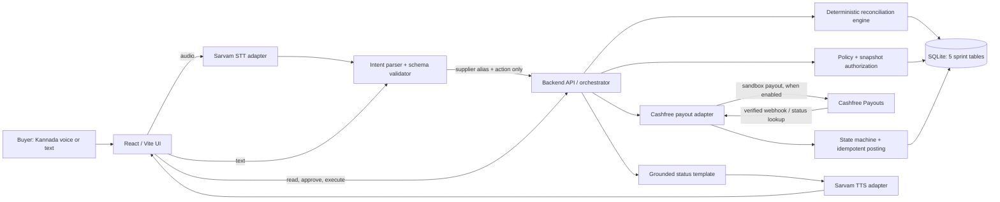
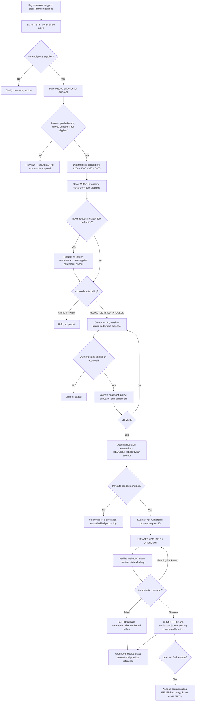
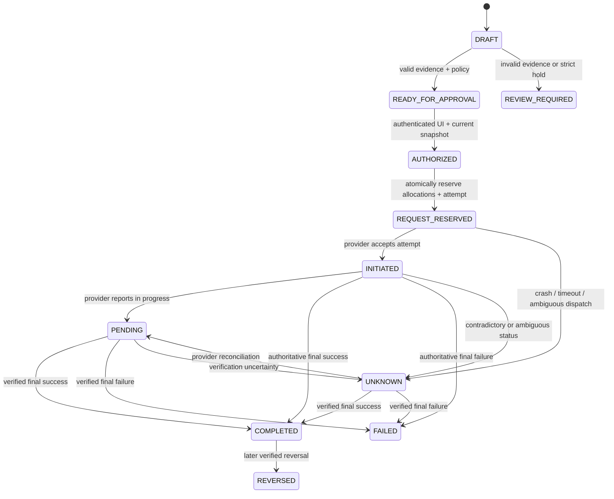

# NIPTA — SYSTEM ARCHITECTURE

**Architecture version:** 1.2 — Nipta buildathon branding; synchronized canonical implementation blueprint  
**Canonical sources:** `problemstatement.txt` v2.3 (product problem) and `PRD.md` v2.7 (requirements and acceptance tests). This architecture is authoritative for implementation contracts. Consolidated from prior v1.1 and five-person ownership blueprint; 20 November 2026.  
**Event:** Cashfree × Sarvam AI Buildathon, Bengaluru — 21 November 2026  
**Scope:** Five-person team, 3.5-hour sprint, seeded Ramesh Vegetables scenario  
**Status:** Implementation blueprint; **Cashfree and Sarvam API details remain unverified** in this environment

> **North star:** From a Kannada utterance to a transparent ₹6,850 payable, refusal of an unsupported ₹500 deduction, explicit authenticated buyer authorization, and truthful supplier payout state. Never let an LLM authorize or calculate a financial transaction.

## 1. Reconciled architecture decisions

This design preserves PRD v2.7's product scope, seeded facts, buyer/supplier definitions, demo sequence, and T01–T16 tests. The following table records the **resolved inconsistencies from earlier versions**, now synchronized into PRD v2.7. Remaining limits and external API uncertainties are explicitly identified.

| Severity | Earlier document gap / ongoing implementation risk | Canonical implementation decision |
|---|---|---|
| Critical | Five-table schema lists `ledger_entries` only as invoices, advances, credits and claims, yet requires an immutable settlement entry and later reversal | Retain five tables for the sprint but extend `ledger_entries.kind` with `SETTLEMENT` and `REVERSAL`, store `payment_attempt_id`, and enforce one settlement posting and one compensating reversal per attempt using partial unique indexes. Longer term split accounting journals into a separate table. |
| Critical | `ADV-019`/`CRD-007` are described as allocated to `INV-104`, while rules also say they are unused until settlement | Separate **invoice matching** from **settlement consumption**. Seed the entries as *linked to* `INV-104` but not yet consumed. Reserve under a settlement before payout; consume only on final success; release on definitive failure. Unknown stays reserved. |
| Critical | Reserving an attempt locally does not guarantee exactly-once provider side effects across crash windows | Use a stable provider request/transfer identifier, persist an attempt before dispatch, recover via provider status lookup; never send another transfer under a new ID while the previous outcome is uncertain. Provider idempotency guarantees must be verified. |
| High | `AUTHORIZED → INITIATED` skips the window before the HTTP request is accepted | Use `REQUEST_RESERVED` internally, then `INITIATED` only when semantics of the provider response justify it; on timeout use `UNKNOWN`. |
| High | Webhook dedupe is necessary but insufficient when different events conflict or arrive out of order | Verify event authenticity on raw payload, store a dedupe key, require valid transitions, and reconcile contradictions through provider lookup. Final success is not downgraded by a late pending event. |
| High | `SUPPLIER_APPROVED` may be confused with trusted proof | Seed exact agreement source/reference; show as **seeded agreement**, not a live WhatsApp verification. No automatic approval from model output. |
| High | Cashfree endpoint names and Sarvam model IDs are not verified | Implement thin adapters using environment variables; do not hardcode or advertise unconfirmed API shapes/events. Confirm with event engineers. |
| Medium | Five full implementations plus 16 tests are ambitious in 210 minutes | Ship Kannada text/pre-recorded audio → evidence → refusal → approval → enabled sandbox transaction/status first; TTS, Hindi, operator policy configuration are cuttable. |
| High | The team-ownership proposal mixes `ISSUED` and `PAYMENT_CONFIRMED` with a narrower credit-status enum | Validate document/payment status per `kind`; keep supplier credit agreement separate from advance/payment confirmation. |
| High | The other proposal puts dispute acknowledgment on `/execute`, despite a distinct `/approve` endpoint | Collect dispute acknowledgment on `/approve`; `/execute` requires prior server-recorded authorization and takes no approval flag. |
| High | Member 1 and Member 3 both appear to own ledger mutation | Member 1 owns transport, signature and status normalization; Member 3 owns transactional state+posting mutation through a single ledger service. |

### Explicit non-goals
No live WhatsApp ingestion, arbitrary invoice OCR, full accounting/ERP, production funds, autonomous credit approval, self-service beneficiary registration, multi-invoice batching, or unrestricted voice authorization. A simulated outbound payout is **not** a successful Cashfree transfer and does **not** independently satisfy a real-money-movement requirement.

## 2. Actors, trust boundaries and invariants

- **Buyer / Nipta user:** Bengaluru restaurant, bakery, cloud kitchen, or produce retailer. Owns the obligation and approves payout.
- **Supplier / payee:** Ramesh Vegetables (`SUP-001`), issuer of the produce invoice and recipient of funds.
- **Cashfree merchant account:** API account with required enabled permissions. This may be distinct terminology from the buyer role; access must be confirmed.
- **Sarvam AI:** Language input/output only. Model output is untrusted, even if formatted as JSON.
- **Backend:** Financial source of truth for the demo, reconciler, approval checker, workflow orchestrator and Cashfree adapter owner.
- **Cashfree:** Outbound transfer executor/status source **only if Payouts sandbox access is enabled**.

**Safety invariants**

1. Money amounts are computed only by integer-paise backend logic; never by model output.
2. An unapproved or disputed supplier credit never reduces the payable amount.
3. A paid advance or agreed credit may only reduce an invoice once, subject to remaining available amount.
4. A short-delivery allegation is not supplier agreement; the ₹500 remains an open claim.
5. The reviewable ₹6,850 is not an order to pay: policy and UI authorization are required.
6. Voice input cannot authorize a payout, alter bank details, or switch dispute policy.
7. One settlement may have at most one *active/uncertain* provider attempt; no automatic new transfer when status is unknown.
8. HTTP acceptance and inbound webhook receipt do not automatically equal verified completed payment.
9. A confirmed successful attempt produces exactly one immutable settlement ledger effect; reversal adds a distinct compensating effect.
10. Server secrets stay server-side, beneficiary values are masked in the browser, and all stage statuses distinguish sandbox from simulation.

## 3. Logical component architecture



**Trust boundaries:** Browser and model outputs are untrusted; only authenticated backend requests and validated server-owned data can change settlements. Provider webhooks are untrusted until verified with the provider's current authentication method. The Cashfree adapter never accepts a payable calculated in the frontend.

### Five-person module boundaries

The architecture is a **modular monolith**: one FastAPI process, one SQLite database, thin Sarvam and Cashfree adapters. Separate directory ownership prevents merge conflicts, but all modules communicate through frozen typed interfaces. **Member 5 owns shared app wiring, config, and contract integration.**

| Owner | Owns | Must not own |
|---|---|---|
| Member 1 — Cashfree | HTTP adapter, raw webhook verification, provider status lookup, normalized provider events | Direct ledger postings, settlement authorization, new transfer IDs on retries |
| Member 2 — Sarvam | Audio input adapter, strict intent parsing, fixed-state-language templates and TTS | Determining payable, beneficiary, payment authority |
| Member 3 — Financial core | SQLite/schema/seed, source eligibility, credit/advance reservations, immutable approvals, transactional state transitions and financial postings | Provider-specific HTTP/event parsing |
| Member 4 — Frontend | Voice controls, evidence table, refusal display, explicit UI approval, status and audit panels | Calculating totals, altering approval flags, setting payment success |
| Member 5 — Integration & QA | Shared routers/wiring, Pydantic contract freeze, env config, full-flow QA, pitch and cutoffs | Silent contract changes after freeze |

**Ownership boundary for success:** Member 1 emits a verified normalized event to `ledger.apply_verified_provider_event(...)` (Member 3). Member 3 atomically updates the payment attempt, consumes allocations and inserts a unique `SETTLEMENT` posting. Webhook handling must never independently set `posting_recorded_at` without that posting.

### Recommended sprint stack

- **Frontend:** Vite + React + TypeScript, one responsive screen. Browser recording or prepared `.wav` selector; typed fallback.
- **Backend:** FastAPI + Pydantic + SQLite (`BEGIN IMMEDIATE` for short critical transactions); `httpx` for external calls. A Node/Express alternative is acceptable if the team already knows it.
- **Data:** Five SQLite tables with uniqueness/check constraints and JSON fields for demo metadata. **Single server process** for sprint; don't claim horizontal scale.
- **Sarvam:** STT, structured intent classification where supported, and optional grounded TTS behind adapters. Confirm actual model IDs, format, language codes and account access.
- **Cashfree:** Payouts sandbox adapter behind a feature gate. Confirm current API version, authentication, beneficiary prerequisites, status endpoint and webhook authentication *before* implementing calls.
- **Secrets/config:** Local `.env` on server, `.env.example` committed, real `.env` excluded from source control.

## 4. End-to-end financial workflow



### Seeded baseline

| ID | Type | Amount | Required eligibility | Demo treatment |
|---|---|---:|---|---|
| `INV-104` | Invoice | +₹8,200 | Buyer-accepted, supplier-matched invoice | Included |
| `ADV-019` | Advance | −₹1,000 | Confirmed completed payment, linked to invoice, unconsumed | Included |
| `CRD-007` | Credit | −₹350 | Explicit supplier agreement to **₹350**, linked, unconsumed | Included |
| `CLM-012` | Claim | −₹500 | Buyer-only missing coriander assertion, no supplier approval | Excluded, open dispute |
| | **Verified payable** | **₹6,850** | Subject to policy and buyer authorization | Proposed payout |

`ADV-019` and `CRD-007` are *invoice-linked* at seed time but not *settlement-consumed*. On successful payout their reserved values become consumed. On verified failure they become available again; on `UNKNOWN` they remain reserved until reconciliation.

## 5. Reconciliation algorithm

Use signed integer paise (`INVOICE` positive; advance/credit negative only if eligible). The core rule is:

```python
# Pseudocode; do not use floating point for currency.
def reconcile(invoice, entries, policy):
    assert invoice.supplier_id == 'SUP-001'
    assert invoice.buyer_accepted and invoice.amount_paise >= 0
    advances = [e for e in entries if valid_confirmed_advance(e, invoice)
                and e.available_paise > 0]
    credits = [e for e in entries if valid_supplier_agreed_credit(e, invoice)
               and e.available_paise > 0]
    excluded = [e for e in entries if e.kind == 'CLAIM' and not e.supplier_approved]
    payable = (invoice.amount_paise
               - sum(e.available_paise for e in advances)
               - sum(e.available_paise for e in credits)
               - invoice.prior_settlement_paise)
    if payable < 0 or invoice.evidence_incomplete:
        return review_required('Invalid or incomplete payable')
    return {'amount_paise': payable, 'included': [invoice, *advances, *credits],
            'excluded': excluded,
            'can_proceed': policy == 'ALLOW_VERIFIED_PROCEED' or not excluded}
```

For v2.7's single seeded invoice, each advance/credit is fully applied or not applied. Partial allocation needs an amount-specific allocation ledger, and is **out of sprint scope**. Track source reference, agreement version, invoice association, remaining availability, and rejection reason. The actual code must not filter records solely by the string `APPROVED`.

## 6. Persistence model: five tables with explicit journal effects

Keep the PRD's five-table sprint target, with the following **clarifications/additions**. This is a pragmatic local-demo schema, not a general-purpose double-entry ledger.

| Table | Columns that matter | Constraints |
|---|---|---|
| `suppliers` | `id`, `merchant_id`, `display_name`, `aliases_json`, `beneficiary_id`, `beneficiary_masked`, `beneficiary_version`, `verification_status` | Supplier owned by buyer; saved beneficiary is never supplied by model output |
| `ledger_entries` | `id`, `supplier_id`, `invoice_id`, `kind`, `amount_paise`, `commercial_state`, `evidence_ref`, `agreement_ref`, `agreement_version`, `linked_invoice_id`, `allocation_state`, `reserved_settlement_id`, `consumed_settlement_id`, `payment_attempt_id`, `reverses_entry_id`, `ledger_version` | `kind ∈ {INVOICE, ADVANCE, CREDIT, CLAIM, SETTLEMENT, REVERSAL}`; distinct reserve/consume; unique completed journal effect per `payment_attempt_id`; unique reversal per original entry |
| `settlements` | `id`, `merchant_id`, `supplier_id`, `amount_paise`, `currency`, `snapshot_json`, `snapshot_hash`, `ledger_version`, `policy_version`, `beneficiary_version`, `state`, `approver_id`, `approved_at`, `expires_at` | Immutable snapshot; authenticated approval; current state/version checked transactionally |
| `payment_attempts` | `id`, `settlement_id`, `provider_request_id`, `provider_ref`, `state`, `dispatch_started_at`, `verified_at`, `posting_recorded_at`, `last_provider_status` | `UNIQUE(settlement_id)` sprint constraint, `UNIQUE(provider_request_id)`; ambiguous result never spawns new ID |
| `audit_events` | `id`, `dedupe_key`, `actor`, `action`, `object_id`, `created_at`, `metadata_json` | Provider event dedupe key unique where present; record decisions and transitions append-only |

### Required SQLite constraints (sprint model)

```sql
CREATE UNIQUE INDEX IF NOT EXISTS one_settlement_posting_per_attempt
  ON ledger_entries(payment_attempt_id)
  WHERE kind = 'SETTLEMENT' AND payment_attempt_id IS NOT NULL;

CREATE UNIQUE INDEX IF NOT EXISTS one_reversal_per_posting
  ON ledger_entries(reverses_entry_id)
  WHERE kind = 'REVERSAL' AND reverses_entry_id IS NOT NULL;

CREATE UNIQUE INDEX IF NOT EXISTS one_attempt_per_settlement
  ON payment_attempts(settlement_id);

CREATE UNIQUE INDEX IF NOT EXISTS unique_provider_request
  ON payment_attempts(provider_request_id);
```

`ledger_entries` also needs explicit checks for allowed `kind`, per-kind `commercial_state` validation (including invoice `ISSUED`/buyer-accepted and advance `PAYMENT_CONFIRMED`), and mandatory journal references. **Do not mix `commercial_state` with payment state**: a reversal has a journal reference, not supplier-credit approval. Represent the source state and payment state in their respective fields/tables.

### Important transactional order

1. **Prepare**: read invoice, verify evidence and available allocations, freeze canonical snapshot, hash and ledger version. No funds move.
2. **Approve**: authenticated UI submits settlement ID; server stores `approver_id`, time and expiry; approval is invalidated on material changes.
3. **Reserve** (`BEGIN IMMEDIATE`): recheck approval/version; atomically reserve the relevant `ADV-019` and `CRD-007` records; create exactly one payment attempt and stable provider request ID; commit before network I/O.
4. **Dispatch**: call provider only after reservation. Store provider response/reference. If process crashes between reservation and dispatch, recovery checks provider status by stable reference **before** any send/re-send. Whether safe same-key re-submission is possible depends on verified provider semantics.
5. **Confirm success** (transaction): transition attempt to `COMPLETED`, create unique `SETTLEMENT` journal entry for ₹6,850, consume reserved source entries, bump ledger version, add audit event. All in one DB transaction.
6. **Confirm failure** (transaction): mark `FAILED`, release reserved source entries if provider establishes no payout happened, audit. Do not create settlement posting.
7. **Uncertain**: retain reservations; display `UNKNOWN/PENDING` and reconcile same provider attempt later. Never silently create a new transfer.
8. **Reverse after completion**: append `REVERSAL` journal event linked to the original posting; audit and reopen/review obligations according to merchant policy. Do **not** blindly mark original advances/credits available without a separate reconciliation decision.

**Limit:** Five-table design assumes single payer, one invoice, one settlement, fully applied advance and credit. If partial credit reuse, concurrent multi-invoice allocations, or real books are needed, introduce an `allocations` table and proper journal lines. Avoid claiming the five-table model solves those production cases.

## 7. Frozen API and module contracts — freeze by 12:45 PM

**These are Nipta's internal routes, not Cashfree endpoint claims.** All response money is integer paise. Member 5 freezes shared Pydantic schemas and frontend TypeScript types before parallel work proceeds. URLs are `POST /api/...`; the module ownership proposal's unprefixed examples are mapped to this canonical scheme.

| Method | Route | Request | Response / guardrail | Owner |
|---|---|---|---|---|
| `POST` | `/api/intent/parse` | multipart: `audio_file` **or** `text_input`, `language` (`kn-IN`, `hi-IN`) | Transcript, input mode, strictly validated intent; *candidate* supplier ID resolved server-side | 2 |
| `GET` | `/api/suppliers/{id}/reconciliation` | authenticated merchant context | ₹6,850, included/excluded evidence, version, eligibility, masked beneficiary | 3 |
| `POST` | `/api/settlements` | `{supplier_id, invoice_id}` | new settlement ID, frozen server-computed snapshot/hash, expiry, status | 3 |
| `POST` | `/api/settlements/{id}/approve` | `{snapshot_hash, acknowledge_open_dispute:true}` | server binds authenticated approver to exact current snapshot; no payout yet | 3 |
| `POST` | `/api/settlements/{id}/execute` | empty body (or `snapshot_hash` check only, never a client amount or dispute approval) | existing or newly reserved attempt, execution mode and current state; no implicit authorization | 3 → 1 |
| `GET` | `/api/settlements/{id}/status` | authenticated merchant | persistent authoritative state, check time, provider reference and `ledger_posted` | 3 (data) + 1 (reconcile) |
| `POST` | `/api/webhooks/cashfree` | unmodified request body + provider headers | verify event, normalize, dedupe, dispatch **through Member 3 state service** | 1 → 3 |
| `POST` | `/api/tts/speak` | `{settlement_id,language}` | TTS of server-defined status text, never client-supplied success text | 2 |

### Shared intent schema (untrusted until validated)

```json
{
  "transcript": "ರಮೇಶ್ ವೆಜಿಟೇಬಲ್ಸ್ ಬಾಕಿ ಕ್ಲಿಯರ್ ಮಾಡಿ",
  "language": "kn-IN",
  "input_mode": "PREPARED_AUDIO",
  "parsed_intent": {
    "intent": "CHECK_BALANCE",
    "supplier_alias": "Ramesh Vegetables",
    "resolved_supplier_id": "SUP-001",
    "requested_deduction_amount_paise": null
  }
}
```

Allowed intent enum: `CHECK_BALANCE`, `REQUEST_DEDUCTION`, `PREPARE_SETTLEMENT`, `CANCEL`, `UNKNOWN`. `resolved_supplier_id` is a server-side lookup result, **not model authority**. An `APPROVE_SETTLEMENT` utterance cannot authorize payment. Report prepared recordings as prepared; never pretend they were spontaneous.

### Canonical reconciliation response

```json
{
  "supplier": {
    "id": "SUP-001",
    "display_name": "Ramesh Vegetables",
    "beneficiary_masked": "UPI: rameshveg@okaxis (BEN-001)",
    "beneficiary_verification_status": "MERCHANT_CONFIRMED_RECORD"
  },
  "invoice_id": "INV-104",
  "dispute_policy": "ALLOW_VERIFIED_PROCEED",
  "ledger_version": 7,
  "currency": "INR",
  "verified_payable_paise": 685000,
  "can_proceed": true,
  "included_records": [
    {"id":"INV-104","kind":"INVOICE","amount_paise":820000,"document_state":"BUYER_ACCEPTED","evidence_label":"PDF_BILL"},
    {"id":"ADV-019","kind":"ADVANCE","amount_paise":-100000,"payment_state":"PAYMENT_CONFIRMED","allocation_state":"UNAPPLIED","evidence_label":"UPI_REF"},
    {"id":"CRD-007","kind":"CREDIT","amount_paise":-35000,"credit_agreement_state":"SUPPLIER_APPROVED","allocation_state":"UNAPPLIED","evidence_label":"WHATSAPP_NOTE"}
  ],
  "excluded_claims": [
    {"id":"CLM-012","kind":"CLAIM","amount_paise":-50000,"claim_state":"DISPUTED","reason":"Supplier agreement to ₹500 shortage credit missing"}
  ]
}
```

**Enum correction:** `ISSUED`, `BUYER_ACCEPTED`, `PAYMENT_CONFIRMED`, and `SUPPLIER_APPROVED` are different domain concepts, not interchangeable values of a credit-approval enum. For a sprint schema with one `commercial_state` column, use a record-kind-aware validation table rather than a global `CHECK` allowing only credit statuses. Better, expose typed `document_state`/`payment_state`/`credit_agreement_state` in the API, mapping seeded storage appropriately.

### Authorization and execution contract

```json
// POST /api/settlements/SET-001/approve
{"snapshot_hash":"<full_sha256_from_server>","acknowledge_open_dispute":true}
```

Success records `approver_id`, `approved_at`, and expiry only after merchant ownership, policy and snapshot validation. **Approval happens here, not at execute.**

```json
// POST /api/settlements/SET-001/execute
{}
```

```json
{
  "settlement_id":"SET-001",
  "payment_attempt_id":"ATT-901",
  "execution_mode":"SANDBOX_PAYOUT",
  "state":"REQUEST_RESERVED",
  "provider_ref":null,
  "amount_paise":685000,
  "ledger_posted":false,
  "status_message":"Payout attempt reserved; provider submission has not yet been confirmed."
}
```

The endpoint may return `INITIATED`, `PENDING`, or `UNKNOWN` when a verified provider response justifies it; it must not synthesize `INITIATED` from a local database insert.

### Shared Python interfaces

```python
# Member 2 — language adapter
transcribe(audio_bytes, language) -> str
parse_intent(transcript, language) -> ValidatedIntent
speak_status(settlement_id, language) -> bytes  # fetches backend-grounded status

# Member 3 — authoritative financial core
reconcile(merchant_id, supplier_id) -> ReconciliationResult
create_settlement(merchant_id, supplier_id, invoice_id) -> FrozenSnapshot
approve_settlement(settlement_id, approver_id, snapshot_hash, acknowledge_dispute) -> Approval
reserve_attempt(settlement_id) -> AuthorizedAttempt  # DB transaction
apply_verified_provider_event(normalized_event) -> StoredState  # DB transaction + journal

# Member 1 — provider-only adapter
send_transfer(attempt_id, authorized_snapshot, provider_request_id) -> ProviderResult
lookup_transfer(provider_request_id) -> ProviderResult
verify_and_normalize_webhook(raw_body, headers) -> NormalizedProviderEvent
```

`send_transfer` receives a **persisted, frozen server-side snapshot** and stable `provider_request_id`; no free-form beneficiary/amount supplied by UI or LLM. Final Cashfree shapes, event names and idempotency behavior remain to be confirmed.

## 8. Payment state machine and confirmation policy

The PRD's public statuses stay recognizable. Add `REQUEST_RESERVED` as an **internal** state to model the crash window before external dispatch.



**Protocol principles:**

- Cashfree adapter maps confirmed vendor statuses into normalized local values. Do not invent actual Cashfree event names or assume HTTP 200 means paid.
- Authenticate provider events using its current documented scheme and raw body; keep credentials server-side.
- Dedupe by stable event identity when provided. If no event ID is available, use a canonical provider-event identity appropriate to that verified API contract, not blindly `timestamp` alone.
- For out-of-order events, do not downgrade `COMPLETED` to `PENDING`; reconcile contradictory finals using provider status. Treat `REVERSED` as a separate verified follow-up event.
- On uncertainty, query status of **the same stable attempt**; retrying a different transfer request is forbidden without resolution and explicit new authorization.
- `SIMULATED` is a distinct provider-mode indicator; it must not be treated as `COMPLETED` or create a financial settlement posting.

## 9. Sequence diagrams

### Happy path: signed-off ₹350 credit, buyer approves ₹6,850

```mermaid
sequenceDiagram
    participant B as Buyer
    participant UI as React UI
    participant S as Sarvam
    participant API as Nipta Backend
    participant DB as SQLite
    participant CF as Cashfree Sandbox
    B->>UI: Speak balance request
    UI->>S: Kannada audio
    S-->>API: Validated intent candidate
    API->>DB: Load invoice, advance, credit, dispute
    DB-->>API: Seeded evidence + allocation availability
    API-->>UI: ₹6,850 + excluded ₹500 claim
    B->>UI: Request disputed ₹500 deduction
    UI->>API: REQUEST_DEDUCTION
    API-->>UI: Refuse; supplier consent absent
    B->>UI: Review and click Approve ₹6,850
    UI->>API: Approve frozen snapshot
    API->>DB: Verify + store authenticated approval
    UI->>API: Execute approved settlement
    API->>DB: Atomic reserve + stable attempt ID
    API->>CF: Transfer request (only if enabled)
    CF-->>API: Accepted / pending reference
    API-->>UI: INITIATED / PENDING (not paid yet)
    CF-->>API: Verified final success via status/webhook
    API->>DB: Atomic COMPLETED + one settlement posting
    API-->>UI: Completed + exact provider reference
    UI->>S: Server-grounded Kannada status template
    S-->>B: Spoken verified result
```

### Duplicate click / timeout protection

```mermaid
sequenceDiagram
    participant UI as Buyer UI
    participant API as Nipta Backend
    participant DB as SQLite
    participant CF as Cashfree Sandbox
    UI->>API: Execute SET-001
    API->>DB: Insert one reserved attempt with unique settlement_id
    API->>CF: Send stable provider_request_id
    Note over API,CF: Network response may be lost
    API->>DB: Mark UNKNOWN (retain reservation)
    UI->>API: Duplicate click Execute SET-001
    API->>DB: Read existing attempt
    API-->>UI: Existing UNKNOWN attempt; no new ID
    API->>CF: Lookup same provider_request_id status
    CF-->>API: Actual provider status
    API->>DB: Apply guarded transition and journal if verified
```

## 10. Security, identity and observability

### Demo authentication and authorization

Use a seeded demo buyer identity/session (`MER-001`) with server-enforced merchant ownership checks; **do not mistake a hardcoded demo session for production authentication**. Approval requires a specific UI click and records `approver_id`, timestamp, expiry, frozen snapshot hash, ledger and beneficiary versions. Use an anti-CSRF mechanism if cookie authentication is used. Any critical policy/beneficiary/evidence change invalidates outstanding approvals.

### Data minimization and audit

- Display beneficiary alias and masked account/VPA only. Do not expose full bank details or API credentials in UI or stage logs.
- Log `merchant_id`, `supplier_id`, `settlement_id`, `payment_attempt_id`, provider request/ref, normalized transition, and response timestamps; redact tokens and account numbers.
- Log the rejected `CLM-012` reason and source references, not inferred supplier consent.
- Store actual webhook verification outcome and event ID (or documented equivalent); replay becomes a no-op.
- Provide visible `SANDBOX`, `PENDING`, `SIMULATED` indicators. A pending result receives no “payment completed” narration.

### Threat-to-control mapping

| Threat | Control |
|---|---|
| Model hallucinates ₹6,350 or invents approval | Model cannot write ledger; deterministic engine computes ₹6,850 from eligible sources |
| Fake supplier alias causes wrong beneficiary | Exact merchant-owned supplier resolution; ambiguous aliases prompt clarification |
| Unverified ₹500 claim deducted | Supplier approval + agreement-version + unused allocation checks |
| Replayed approval / double click | Unique settlement attempt, stable provider ID and transactional reserve |
| Webhook forgery or duplicate | Raw-body authentication, dedupe and guarded state transition |
| Provider timeout causes double payout | `UNKNOWN` with reconciliation against same attempt; no new transfer ID |
| Stale credit/beneficiary version | Recompute, invalidate approval, require fresh UI review |
| Unverified payment success announcement | Spoken template generated only from confirmed persisted state |

## 11. Failure handling and recovery matrix

| Failure | User-visible state | Recovery rule |
|---|---|---|
| STT fails / auditorium noisy | Ask to retry; typed/prepared audio available | No financial action |
| Supplier alias ambiguous | Clarification required | Do not select beneficiary automatically |
| Invoice/advance evidence inconsistent | `REVIEW_REQUIRED` | No executable settlement |
| Merchant requests ₹500 unsupported deduction | Refusal; payable remains ₹6,850 | Keep claim open, explain missing supplier approval |
| `STRICT_HOLD` active with open dispute | Review only | No approval/execution |
| Approval expired or ledger changed | Reapproval required | New snapshot and explicit click |
| Cashfree Payouts unavailable | `SIMULATED_DISBURSEMENT` | Demonstrate logic only; not a real payout |
| Provider call times out | `UNKNOWN` | Reconcile stable request ID, do not issue new payout |
| Provider reports pending | `PENDING` | Status lookup/verified webhook, no ledger settlement posting |
| Provider confirms failure | `FAILED` | Release reservation after verified no payment |
| Authenticated webhook replay | No visible change | Dedupe and unique posting constraint |
| Verified reversal after completion | `REVERSED` | Append linked compensating entry; retain audit |

## 12. Demo UI layout

```text
┌───────────────────────────────────────────────────────────────────────────┐
│ NIPTA  |  Kannada primary  |  BUYER → SUPPLIER  |  SANDBOX / SIMULATED     │
├────────────────────────────────┬──────────────────────────────────────────┤
│ VOICE / TEXT                   │ EVIDENCE LEDGER                          │
│ [Record] [Prepared WAV] [Type] │ INV-104  Invoice          +₹8,200       │
│ "Clear Ramesh balance"         │ ADV-019  Paid advance     −₹1,000       │
│                                │ CRD-007  Agreed credit    −₹350         │
│ AGENT RESPONSE                 │ CLM-012  Missing coriander −₹500        │
│ "₹500 claim not approved."     │          DISPUTED: EXCLUDED              │
│                                │ VERIFIED PAYABLE          ₹6,850        │
├────────────────────────────────┴──────────────────────────────────────────┤
│ EVIDENCE: SEEDED AGREEMENT | BENEFICIARY: MERCHANT-CONFIRMED | PAYMENT: — │
│ Policy: ALLOW_VERIFIED_PROCEED (read-only)                                │
│ Open ₹500 claim remains unresolved.                                      │
│ [Defer]   [Proceed with ₹6,850 despite open claim]                        │
│ [Review frozen snapshot] [Approve ₹6,850] [Execute approved payout]       │
│ Status: DRAFT → AUTHORIZED → REQUEST_RESERVED → PENDING → COMPLETED       │
│ Audit: snapshot hash | attempt ID | provider reference | event history   │
└───────────────────────────────────────────────────────────────────────────┘
```

The authorization and execution controls should appear only in their valid state; the UI mockup above demonstrates layout, not simultaneous button enablement. A real Cashfree status must always be labeled precisely. If sandbox payout cannot complete, showing `PENDING` is acceptable; fabricating completion is not.

### Cross-document contract freeze

`problemstatement.txt` v2.3 owns the customer problem and commercial claims; `PRD.md` v2.7 owns behavior, scope and T01–T16 acceptance criteria; this `architecture.md` v1.2 owns **implementation details**, schema invariants, `/api/...` endpoint contracts and state recovery. Freeze all shared request/response JSON contracts at **12:45 PM** (not 1:15 PM), with Member 5 as the only editor of shared router/contracts files; integrate continuously after that. `REQUEST_RESERVED` is internal and does not signal provider acceptance. The seeded evidence is illustrative, not live third-party verification. Cashfree endpoints, authentication and webhook semantics remain unverified until confirmed at kickoff.

## 13. Repository layout, exclusive file ownership and integration checkpoints

Adopt the other agent's **directory-owned modular monolith**, while retaining the financial engine's single-writer posting boundary. All shared integration files are owned by **Member 5**. Avoid a Next.js server plus FastAPI when a Vite + React frontend and FastAPI backend suffice.

```text
nipta/
├── README.md                          # Member 5
├── PRD.md                             # Canonical product requirements (v2.7)
├── architecture.md                    # This consolidated engineering design
├── .env.example                       # Member 5; no secrets
├── backend/
│   ├── main.py                        # Member 5 — all routers, CORS, error middleware
│   ├── config.py                      # Member 5 — environment / provider gates
│   ├── contracts.py                   # Member 5 — shared Pydantic request/response models
│   ├── db/
│   │   ├── schema.sql                 # Member 3 — five-table DDL + uniqueness constraints
│   │   ├── seed.py                    # Member 3 — Ramesh scenario
│   │   └── database.py                # Member 3 — WAL, BEGIN IMMEDIATE transactions
│   ├── modules/
│   │   ├── sarvam/                    # Member 2 only
│   │   │   ├── router.py              # /api/intent/parse, /api/tts/speak
│   │   │   ├── stt_client.py
│   │   │   ├── intent_parser.py
│   │   │   ├── tts_client.py
│   │   │   └── response_templates.py  # grounded Kannada/Hindi
│   │   ├── ledger/                    # Member 3 only
│   │   │   ├── router.py              # reconciliation, settlements, approve, execute
│   │   │   ├── calculator.py          # integer paise, evidence eligibility
│   │   │   ├── policy.py              # strict hold / allow verified proceed
│   │   │   ├── snapshot.py            # canonical JSON, SHA-256
│   │   │   └── lifecycle.py           # sole DB mutation path: statuses + postings
│   │   └── cashfree/                  # Member 1 only
│   │       ├── router.py              # raw Cashfree webhook receiver
│   │       ├── adapter.py             # configured Payouts adapter / simulation
│   │       ├── verifier.py            # provider signature and state lookup
│   │       └── mapper.py              # provider -> normalized events
│   └── tests/
│       └── test_safety_gates.py       # Member 5 — T01–T16 and focused A01–A06
├── frontend/                          # Member 4 only
│   ├── src/App.tsx                    # one page
│   ├── src/api/client.ts             # typed contract wrappers
│   └── src/components/
│       ├── VoiceCommandBar.tsx       # mic, prepared WAV, text
│       ├── EvidenceLedger.tsx        # invoice/credit/advance/dispute + trust badges
│       ├── PolicyHeader.tsx          # read-only policy and operator route
│       ├── ApprovalCard.tsx          # dispute acknowledgement, explicit approval
│       ├── StatusTimeline.tsx        # request-reserved/pending/completed
│       └── AuditDrawer.tsx           # snapshot, attempt, posted entries
└── demo_assets/                      # Member 2 recordings; Member 5 labels/rehearsal
    ├── kn_clear_balance.wav
    └── kn_deduct_500.wav
```

### Ownership and integration rules

1. **12:30–12:45:** Member 5 freezes `contracts.py`, the API response fixtures, enum names and directory map with all owners. The example JSON in §7 is normative for demo wiring.
2. Each member edits only owned files. Changes affecting a cross-module interface must go through Member 5, not arbitrary shared edits.
3. Member 3 owns `backend/db/` and `ledger/lifecycle.py`; Member 1 **calls**, but never mutates, ledger tables or `payment_attempts` directly.
4. Member 5 owns `main.py` and provider/config wiring. No SSE is required for MVP: poll `/api/settlements/{id}/status` at a modest interval; avoid adding streaming complexity.
5. Member 4 builds first against `GET /reconciliation` fixture and the approve/execute mock response. Member 2 and Member 1 can use the same fixtures until their adapters are ready.
6. Member 2 stores prepared audio under `demo_assets` and labels recordings honestly in the UI; Member 5 ensures files are committed and playable.

### Milestones (210-minute sprint)

| Time | Target | Exit criterion / scope decision |
|---|---|---|
| **12:30–12:45** | Cashfree Payouts and Sarvam access check; freeze contracts/schema ownership | Confirm actual payout eligibility; choose truthful sandbox vs simulated path |
| **12:45–1:15** | Parallel compile with shared fixtures; seed DB and wire routers | All modules import cleanly; frontend displays seeded evidence |
| **1:15–2:15** | Connect Kannada input → ₹6,850 breakdown → ₹500 refusal → snapshot approval | `T01`, `T02`, `T04`, `T05` pass end to end |
| **2:15** | **Hard scope cut** | Drop Hindi, noisy live mic tuning, streaming, optional policy settings before safety/integration |
| **2:15–3:00** | Payout status adapter, single attempt and ledger posting; TTS only if time | Provider state truthful; no unauthorized execution or duplicate postings |
| **3:00–3:40** | Failures, concurrency, timeout, webhook replay, used-credit/advance tests | Prioritize `T06–T09`, `T13–T16`, plus crash recovery |
| **3:40–4:00** | Code freeze, 180-second rehearsals, submission | Stage demo functional with honest fallback |

**Dependency warning:** Member 3 is the critical-path owner for DB, reconciliation, approvals, and postings. Member 5 should pair with Member 3 on schema/tests once router wiring is stable; Member 1 can own provider mocks and normalized events early to unblock the ledger's lifecycle tests.

## 14. Test plan mapped to PRD v2.7

Preserve the PRD test IDs and expected behavior:

- **T01–T03:** Baseline ₹6,850, ₹500 refusal, and strict-hold payout block.
- **T04–T06:** Modified snapshot invalidation, no voice-only approval, one attempt despite concurrent clicks.
- **T07–T10:** Provider timeout does not cause duplicate transfer; webhook replay/out-of-order callback cannot double-post; reversal appends compensation.
- **T11–T12:** Disabled Payouts is explicitly simulated; spoken status matches DB exactly.
- **T13–T16:** Internal buyer approval and supplier receipt acknowledgment are insufficient; already-consumed advance/credit cannot be reused.

**Additional architecture-focused tests proposed:**

- **A01:** Process crash after DB reservation but before the outbound API call: restart must not submit a second payment blindly.
- **A02:** Allocation reservation and attempt insertion roll back together if a uniqueness constraint fails.
- **A03:** Ledger changes between proposal and approval invalidate the snapshot.
- **A04:** Duplicate success provider events with different event IDs still produce only one settlement posting.
- **A05:** `UNKNOWN` blocks allocation reuse, and a confirmed final failure releases it.
- **A06:** Later reversal produces one separate compensating posting, without deleting the first.

## 15. Open integration decisions (do not guess)

**Cashfree — must establish with docs/engineers:**

1. Is **Payouts sandbox** enabled for this team? Can a pre-registered supplier beneficiary receive a test transfer?
2. Which *current* endpoints, authentication scheme, headers and request identifiers apply? The older `/payout/v1/...` examples are **not** approved implementation contracts.
3. Does the provider guarantee idempotent retries by a client-supplied transfer ID, and how is a transfer queried after timeout?
4. Which webhook event types, raw-body verification/signature rules, retries and terminal statuses are authoritative?
5. What does sandbox `SUCCESS` mean and how quickly might a final state appear?
6. If Payouts is unavailable, which **distinct Cashfree Payments collection** use case is permitted for a separately scoped demo? Never rebrand a payment link as a supplier payout.

**Sarvam — must establish:** current STT/TTS/model identifiers, supported Kannada and Hindi audio formats, sample rate, latency and structured-output support. Retain prepared audio/typed fallback even if real mic works.

## 16. Definition of done

Nipta's demo is complete when the team can show an actual or transparently prepared Kannada input, deterministic ₹6,850 calculation, rejection of the unsupported ₹500 missing-coriander deduction, review of approved sources, authenticated exact-amount confirmation, and an **honestly represented** provider transaction state. A **successful live Cashfree integration** additionally requires a verified API action and provider evidence—not a simulator or a local success flag.

**Production caveat:** This design intentionally chooses a seeded single-invoice, local-DB, sprint-constrained ledger and one sandbox payout attempt. Before handling production funds, reassess accounting journal design, partial allocations, durable job dispatch, multi-process locking, identity/KYC and permissions, provider reconciliation, comprehensive monitoring, and regulatory/security requirements.
